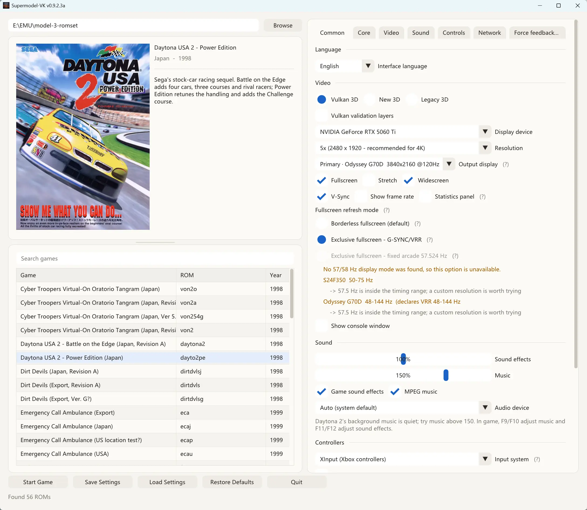
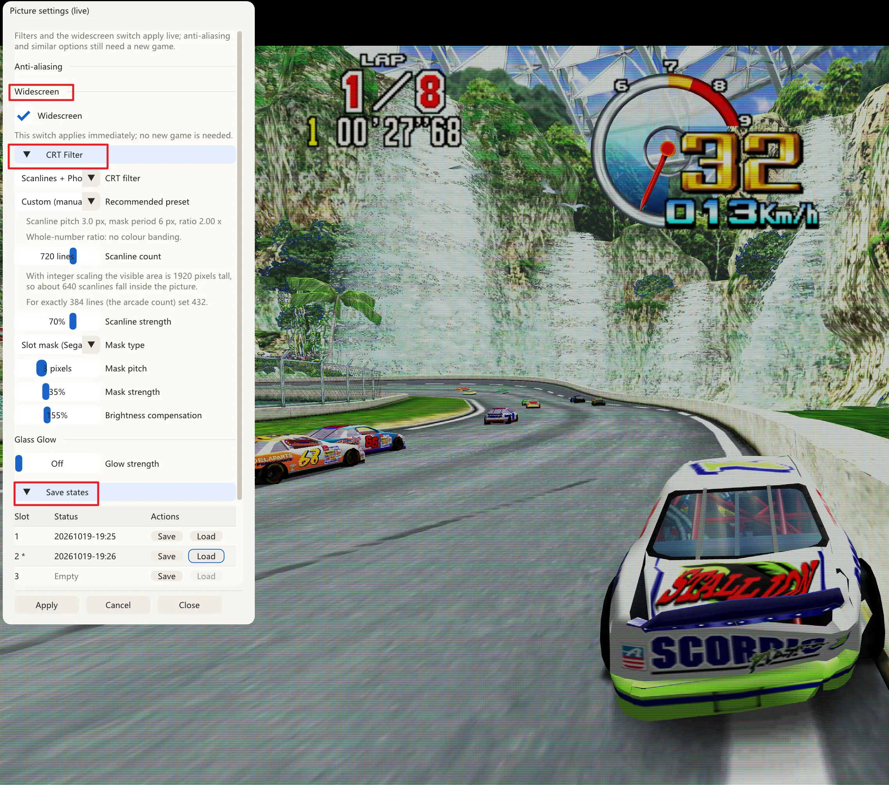
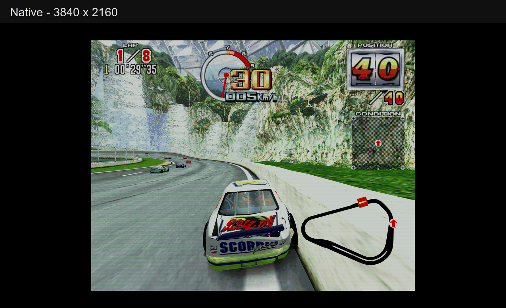

# Supermodel-VK

**A Vulkan-focused fork of [Supermodel](https://github.com/trzy/Supermodel), the open-source Sega
Model 3 arcade emulator.**

## 🚧 Sega Model 3 Arcade Emulator ## released **v0.9.2**!  
This update focuses heavily on refining the UI/launcher experience and introducing a seamless in-game overlay menu, alongside several long-awaited bug fixes.

### 🎮 UI & Launcher Enhancements
* **Integrated Box Art & Cover Display:** Game covers are finally here! The game list now displays box art, making title browsing much more visual and intuitive.
* **Smoother Input Configuration:** Resolved the micro-stutter/lag that occurred whenever navigating to the controls page. Button mapping has also been moved forward for quicker, more ergonomic access.
* **Streamlined UI Text:** Stripped away redundant and cluttered descriptions from the original interface for a cleaner, modern look.
* **Custom Resolution Fix:** Fixed a bug where custom resolution settings failed to take effect.

<div align="center">
  
  <p><em>▲ New UI layout featuring integrated box art display</em></p>
</div>

### 🖥️ In-Game Experience & Graphical Fixes
* **New In-Game Quick Menu (OSD):** Bring up an in-game menu at any time during gameplay to toggle widescreen mode on the fly, cycle through CRT shaders/filters, and manage save states—all without having to exit back to check.

<div align="center">
  
  <p><em>▲ Quick in-game overlay for real-time video, shader, and save state adjustments</em></p>
</div>

* **Visual & Rendering Fixes:**
  * Fixed an issue where an abnormal blue line would occasionally appear along the top edge of the screen in certain titles.
  * Resolved geometry rendering bugs (e.g., the dinosaur boss glitch in *The Lost World: Jurassic Park* where the eyes and flesh separated from the skeleton).

---
## Download and run

No installer. Grab the archive for your platform from the
[latest release](https://github.com/Igloo-Garage/Supermodel-VK/releases/latest):

| Platform | Archive | Start it with |
| --- | --- | --- |
| Windows 10/11 (64-bit) | `Supermodel-VK.v…for.Windows.zip` | double-click `supermodel.exe` |
| Linux (x86-64) | `Supermodel-VK.v…for.Linux.tar.gz` | `./supermodel` |
| macOS 11+ (universal) | `Supermodel-VK.v…for.macOS.tar.gz` | `./supermodel` |

### Windows

1. Extract the `.zip` anywhere you can write to. Keep the folder together — the executable and the
   data folders beside it are the program.
2. Run `supermodel.exe`. The settings window opens directly.
3. Use the path field at the top of the left column (or its **Browse** button) to point at the folder
   holding your ROM set `.zip` files. The archive ships an empty `ROMs/` folder you can use.
4. Double-click a game, or select it and press **Start Game**.

### Before first run

**For Ubuntu / Debian users:**

```bash
sudo apt update
sudo apt install libsdl2-2.0-0 libsdl2-net-2.0-0 libglu1-mesa libgl1 zlib1g
sudo apt install libvulkan1 mesa-vulkan-drivers   # Vulkan renderer; OpenGL works without it
sudo apt install zenity fonts-noto-cjk            # optional: Browse dialogs + Chinese UI text
```

- `zenity` is what the **Browse** buttons call. KDE users can install `kdialog` instead. Without
  either, type the path by hand.
- `fonts-noto-cjk` is only for the Chinese interface; `fonts-wqy-microhei` is a much smaller
  substitute. The English UI works without either.
- `mesa-vulkan-drivers` provides Vulkan for AMD/Intel GPUs. NVIDIA's proprietary driver ships its
  own ICD, so the package is unnecessary there (and harmless if installed).
- Then extract and run:

  ```bash
  tar -xzf Supermodel-VK.*.for.Linux.tar.gz
  cd Supermodel-VK.*
  ./supermodel
  ```

- `Permission denied` → `chmod +x supermodel`.
- `error while loading shared libraries` → `ldd ./supermodel | grep "not found"` names what is
  missing.
- No window over SSH: it needs an X11/Wayland session. If Wayland misbehaves, try
  `SDL_VIDEODRIVER=x11 ./supermodel`.
- Optional diagnostics: `sudo apt install vulkan-tools mesa-utils`, then `vulkaninfo --summary`
  and `glxinfo -B`. If OpenGL fails on a minimal install, add `libgl1-mesa-dri`.
- No sound: make sure PipeWire (`pipewire-pulse`) or PulseAudio is running.
- Linux builds are less battle-tested than Windows; please report issues with your GPU/driver and
  the terminal output. Add `-log-output=Supermodel.log` to write a log file next to the executable.

**For macOS users:**

macOS Gatekeeper fix: because the build isn't Apple-notarized, macOS will block it as an
"unidentified developer." To unblock it:

1. Open **Terminal**.
2. Type `xattr -c -r ` *(make sure there is a space after `-c -r`)*.
3. Drag the unzipped Supermodel-VK folder directly into the Terminal window (it will paste the full
   path automatically).
4. Press **Enter**. You can now launch the emulator normally.

**macOS performance:** Vulkan runs via MoltenVK (translating Vulkan to Metal). On some setups this
overhead can lower frame rates. If you encounter slowdowns, switch the renderer to **OpenGL** in the
settings window — it shares the same emulation core and visual features.

### All platforms

- No game data is included. You need your own Model 3 ROM sets, one `.zip` per game.
- The build is not code-signed. If Windows SmartScreen shows "Windows protected your PC", choose
  **More info → Run anyway**.
- Vulkan is the default renderer and needs a Vulkan 1.3 driver (1.2 with dynamic rendering and
  synchronisation2 also qualifies); otherwise the emulator falls back to OpenGL 4.1 for that
  session and says so in the settings window.
- `Esc` returns to the settings window instead of quitting; `Tab` opens the in-game quick settings.
- Settings, NVRAM, save states and logs stay next to the executable (`Data\` on Windows;
  `Config/`, `NVRAM/`, `Saves/`, `Screenshots/` in the extracted folder on Linux and macOS).
  Moving the executable on its own starts with fresh settings.

---

## What this fork changes

The emulation core comes from Supermodel. The rendering, presentation, audio, input and
interface layers are reworked here:

**Vulkan 1.3 backend** — `Src/Graphics/Vulkan3D/`, alongside the original OpenGL renderers. Per-frame
vertex arenas are protected by fences, so long sessions do not leak or develop black patches.

**CRT post-processing** — scanlines, phosphor masks (aperture grille / slot / shadow) and glass glow,
all computed from an integrated beam profile rather than point-sampled. Point sampling beats into
broad light and dark bands at 4K; integrating over each pixel's footprint removes that dependency and
lets any scanline count render smoothly. There is no geometry or curvature option — this does not
attempt to simulate a spherical tube.


**Widescreen without stretching** — Widescreen widens the 3D field of view instead of scaling the
picture horizontally, so the extra width is real scenery and the HUD stays anchored to the screen
edges. The image below alternates between native aspect and widescreen; both are the same scene,
car and camera position.

<p align="center">
  
</p>


**Standalone ImGui settings window** — the settings screen is the application shell. It stays alive
for the whole run, so `Esc` returns to it instead of quitting the program, the way PCSX2 and other
emulators behave. Settings that need a fresh session say so; the rest apply immediately.

**Three exclusive sync modes** — exclusive fullscreen at a fixed 57.5242 Hz arcade rate, exclusive
fullscreen where G-SYNC/VRR tracks the emulator rate, and borderless. The statistics panel reports
which one is actually in effect and what the panel is doing, because a mode being selected and a mode
being honoured are different things.

**Decoupled multi-threaded audio** — sample generation is fractional per frame rather than rounded,
the sound board runs on its own thread, and the output buffer adapts. A non-integer ratio between
57.5242 Hz and a 60 Hz display produces a click every few seconds otherwise.

**Integer scaling that reports itself** — the multiple is derived from the panel's real resolution
(`384 × N ≤ panel rows`), never from the resolution preset, and the settings window shows the multiple
actually in effect plus the row count the next step would need. A 2160-row 4K panel reaches 5×
(2480×1920) and no further; 6× needs 2304 rows, which no 16:9 4K panel has.

**Hot-plug gamepads** — on the `sdl` and `sdlgamepad` input systems, a pad attached or detached
mid-game is picked up without restarting. The other backends still enumerate once at start-up.

**Chinese and English interface** — with the input binding table translated in both directions, since
those strings originate in English for the console and the log.

No game data is included or distributed. You need your own ROMs.

---

## Build from source

Only needed if you want to modify the code or build for a platform without a release archive.
Release users can stop after **Download and run** above.

### Fetch the libraries first

The third-party trees are deliberately not committed — they are large and are restored on demand:

```
Libraries\Get_Libs.cmd
```

This pulls SDL2, zlib, Vulkan-Headers and glslang. On Linux or macOS use the equivalent
`git clone` commands in `Libraries/DIR.txt`, or install the distribution packages.

### Windows (Visual Studio)

Open `MSVC\Supermodel.sln` and build **Release x64**, or from a developer command prompt:

```
msbuild MSVC\Supermodel.sln /m /p:Configuration=Release /p:Platform=x64
```

`build.bat` does the same and then assembles a runnable folder under `dist\`.

The project asks for the v145 toolset and falls back to the newest installed one, so Visual Studio
2022 works as well as 2026.

### Windows (MSYS2 / GCC)

After installing MSYS2:

```
pacman -S mingw64/mingw-w64-x86_64-gcc
pacman -S mingw64/mingw-w64-x86_64-make
pacman -S mingw64/mingw-w64-x86_64-SDL2
pacman -S mingw64/mingw-w64-x86_64-SDL2_net
```

Ensure `gcc` and `mingw32-make` are on your path (`/mingw64/bin` in the MSYS2 shell, or
`C:\msys64\mingw64\bin` for a normal command prompt), then:

```
mingw32-make -f Makefiles/Makefile.Win32
```

### Linux

```
sudo apt install build-essential pkg-config libsdl2-dev libsdl2-net-dev libglu1-mesa-dev zlib1g-dev libwebp-dev
sudo apt install libvulkan1 mesa-vulkan-drivers   # runtime for the Vulkan renderer
make -f Makefiles/Makefile.UNIX
```

The binary is written to `bin/supermodel`; run it from the repository root so it picks up `Config/`
and `Assets/`. Vulkan headers are vendored under `Libraries/Vulkan-Headers`, so no Vulkan SDK is
required to build.

### macOS

```
xcode-select --install
```

Install SDL2 and SDL_net from <https://github.com/libsdl-org/SDL/releases> and
<https://github.com/libsdl-org/SDL_net/releases> into `/Library/Frameworks`, then:

```
make -f Makefiles/Makefile.OSX
```

A binary downloaded or built elsewhere needs one-time execution permission: right-click it in
Finder, choose **Open**, and confirm. See
<https://support.apple.com/guide/mac-help/open-a-mac-app-from-an-unidentified-developer-mh40616/mac>.

The macOS release is a universal binary (Apple Silicon and Intel), but it is packaged as a bare
Unix executable rather than a `.app`. Keep `supermodel` in the extracted folder next to
`Frameworks/`, open Terminal there, and run `./supermodel`. MoltenVK is bundled in `Frameworks/`,
so Vulkan 3D works without Homebrew or the Vulkan SDK; a system MoltenVK is also detected if
present. Without either, the emulator falls back to the OpenGL New 3D renderer. The bundled
MoltenVK is Apache-2.0; see `Frameworks/LICENSE-MoltenVK.txt`.

### Shaders

The Vulkan shaders are compiled to SPIR-V by `Scripts/CompileVulkanShaders.cmd` (Windows) or
`Scripts/CompileVulkanShaders.sh`. The generated `.spv.h` headers are committed, so a plain source
build does not need glslang installed; the `.spv` intermediates are not committed.

---

## Requirements

| | |
|---|---|
| OS | Windows 10/11 (64-bit), Linux, or macOS 11+ |
| Vulkan | Driver providing Vulkan 1.3, or Vulkan 1.2 with `VK_KHR_dynamic_rendering` and `VK_KHR_synchronization2` — for the Vulkan 3D renderer |
| OpenGL | Driver providing OpenGL 4.1+ — for the New 3D and Legacy 3D renderers |

Nothing else needs installing on Windows: the C++ runtime, SDL2 and SDL2_net are linked
statically, so the executable has no DLL dependencies beyond `vulkan-1.dll`, which the graphics
driver provides. The Linux build links SDL2, SDL2_net, GL and GLU dynamically, so those runtime
packages must be installed (see the `apt` line above). Vulkan is loaded at runtime and is optional:
without `libvulkan1` and a driver the emulator uses OpenGL.

---

## Version numbering

The version is written down in exactly one place, `Src/Version.h`:

```c
#define SUPERMODEL_VERSION      "0.3a-WIP"     /* upstream core; recorded in save states */
#define SUPERMODEL_FORK_VERSION "0.9.0.3a"
#define SUPERMODEL_FORK_DATE    "20261017"
```

`SUPERMODEL_TITLE_FULL` is assembled from the last two, and `build.bat` reads the same lines through
`Scripts/VersionString.ps1`. `SUPERMODEL_VERSION` is kept separate on purpose: it is stored in save
states and NVRAM, so changing it would invalidate every save a user already has.

---

## Relationship to Upstream

Supermodel-VK maintains an ongoing synchronization tracking upstream Supermodel's hardware emulation
core, while intentionally preserving independent modern subsystems.

### Core Emulation Tracking

- **Instruction Semantics:** Regularly backports MAME-aligned PowerPC arithmetic and bit-rotation
  fixes (`sraw`, `subfme`, `rlw*`) and standardized cross-architecture NaN handling across x86-64
  and ARM.
- **Topology Architecture vs. QuadTriFix:** Upstream's New3D pipeline relies on a geometry shader
  fix (QuadTriFix) to handle synthetic quad degradation. Supermodel-VK's Vulkan pipeline bypasses
  this defect at the architectural level: `CopyVertexData` splits quads directly into native dual
  triangles (`0,1,2` and `0,2,3`) submitted via `VK_PRIMITIVE_TOPOLOGY_TRIANGLE_LIST`, ensuring
  zero degenerate vertex overhead or depth corruption.

### Intentional Divergences

- **Decoupled Low-Latency Audio:** Supermodel-VK maintains a proprietary, decoupled multi-threaded
  audio architecture (fractional per-frame sample accumulators and adaptive buffer scaling).
  Monolithic upstream audio merges are intentionally isolated to prevent audio underruns and thread
  starvation.
- **Specialized Machine Profiles:** Upstream PRO-1000 experimental profiles remain decoupled until
  their storage and tilegen logic can be cleanly mapped onto the modern Vulkan memory arena.

---

## Documentation

- [`Docs/README.txt`](Docs/README.txt) — Comprehensive upstream hardware reference, emulator CLI
  parameters, and system manual.
- [`Docs/README-VK.txt`](Docs/README-VK.txt) — Detailed technical manual for Vulkan renderer
  configurations, VRR presentation, and shader tuning.
- [`Docs/安装说明.txt`](Docs/安装说明.txt) — 简体中文快速配置指南（控制器映射推荐、Vulkan 驱动兼容性与常用画质选项）。

---

## Hardware Notes & Technical Limits

- **Gamepad Hot-Plugging:** Dynamic device reconciliation is supported on modern SDL input paths
  (`sdl` and `sdlgamepad`). Legacy API targets (`xinput`, `dinput`, `rawinput`) enumerate devices
  once at initialization and require a session restart.
- **Controller Trigger Topologies:** Certain hardware (such as 8BitDo gamepads operating in Nintendo
  Switch mode) maps L2/R2 triggers digitally, reporting discrete binary on/off states rather than
  analogue continuous ranges. This reflects vendor hardware firmware protocol behavior rather than
  emulator input polling.
- **Integer Scaling Multiples on 16:9 Displays:** Integer scaling factors ($\times4$, $\times6$,
  $\times8$) require native vertical pixel bounds of 1536, 2304, and 3072 scanlines. On standard
  16:9 displays, 1440p panels cap cleanly at $\times3$, while 2160p (4K) panels advance to $\times5$.
- **Widescreen Frustum & CRT Beam Alignment:** Enabling widescreen geometry widens the visible 3D
  frustum into sub-rectangles outside the classic 4:3 raster viewport. CRT beam-profile scanline
  masks compute across the native display raster grid, accurately mirroring physical tube phosphor
  alignment.

---

## Support & Sponsorship

Supermodel-VK and our arcade rendering tools are 100% free and open-source. Development is fueled by
late-night reverse engineering, hardware validation, and community passion.

If you find this project valuable and would like to support display testbeds, hardware acquisitions,
or early release previews, consider supporting via Ko-fi:

[](https://ko-fi.com/igloogarage)

*Monthly backers get early testing snapshot builds and devlogs covering low-level Vulkan rendering
milestones.*

---

## Community

- **Discord:** *Coming soon (server in setup)*
- **GitHub Discussions / Issues:** Open for technical discussions, bug reports, and hardware feedback.

---

## License & Credits

Supermodel-VK is licensed under the **GNU General Public License v3.0 (GPLv3)**. See
[`Docs/LICENSE.txt`](Docs/LICENSE.txt) for details.

This project is a modernized Vulkan 1.3 architecture fork building upon the reverse-engineering
foundations laid by Bart Trzynadlowski, Nik Henson, Ville Linde, Stefano Teso, and the Supermodel
team. Third-party components and attribution details are documented in [`NOTICE.md`](NOTICE.md).
