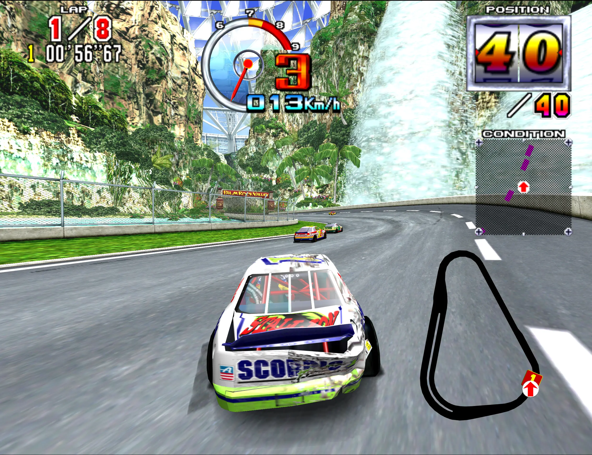
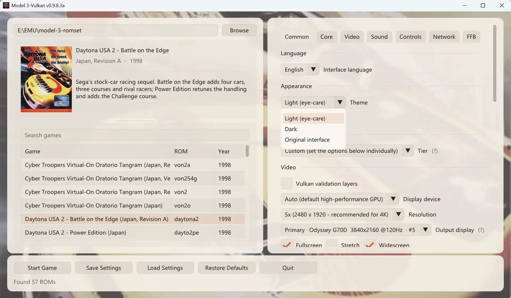
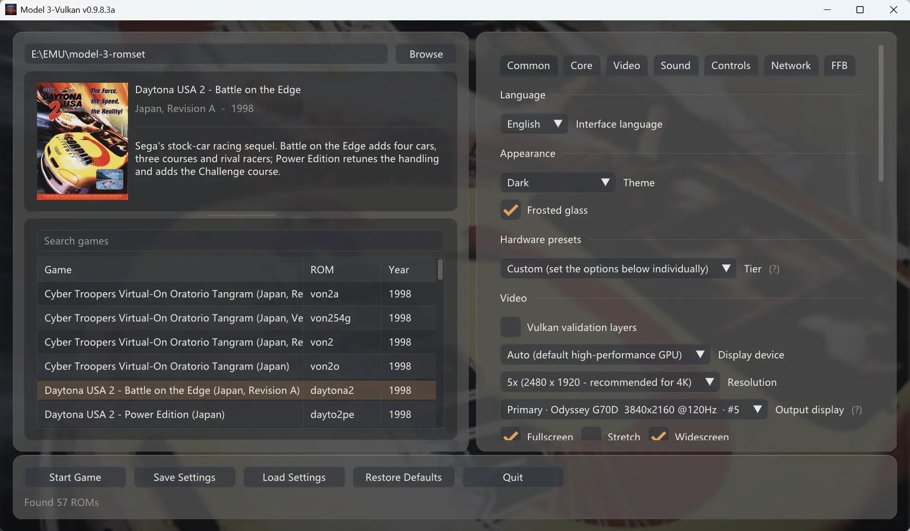

<div align="center">

  <h1>Model 3-Vulkan</h1>

  <p><strong>A modern, standalone Sega Model 3 arcade emulator powered by pure Vulkan 1.3 & SDL3.</strong></p>
  <p><em>(Formerly Supermodel-VK, an independent evolution tracking upstream <a href="https://github.com/trzy/Supermodel">Supermodel</a>)</em></p>

  <p>
    <a href="https://github.com/Igloo-Garage/Model-3-Vulkan/releases">
      
    </a>
    <a href="Docs/LICENSE.txt">
      
    </a>
    <a href="https://www.reddit.com/r/Model3Vulkan/">
      
    </a>
    <a href="https://ko-fi.com/igloogarage">
      
    </a>
  </p>

</div>
---

## 🌟 Overview

**Model 3-Vulkan** is an independent, high-performance evolution of the open-source Sega Model 3 arcade emulator. 

Re-architected from the ground up, the project transitions away from legacy OpenGL constraints in favor of a modern **pure Vulkan 1.3 rendering pipeline**, a cycle-accurate **Real3D graphics simulation**, a **native HD Texture Pack engine**, and an intuitive **frosted-glass eye-care UI**.

---

## 🩹 What's New in v0.9.8.3b

A maintenance release on top of the v0.9.8.3a milestone:

* **Sound effects restored in every game**: a misplaced `else` cleared the SCSP buffers immediately after they had been filled, so every title played its MPEG music with no effects at all. Engine, tyre, collision and menu sounds are back; music, quad mixing and save states are unchanged.
* **Hardware-compressed HD textures**: packs can now ship `.dds` (BC1/BC2/BC3/BC5/BC7) and zstd-compressed `.dds.zst` images. They are uploaded to VRAM in resumable chunks, with `.dds.zst` > `.dds` > `.webp` > `.png` precedence when several files share a hash.
* **F4 toggles HD replacements / F3 rescans**: compare a pack against the original artwork without opening the in-game panel.
* **Vulkan synchronisation fixes**: the 3D scene targets are handed to the 2D compositor on every exit path, including the white-flash frame, which removes the one-frame `VUID-vkCmdDraw-imageLayout-00344` warning.

## 🚧 What's New in Milestone v0.9.8.3a

This release marks the official graduation of the project into **Model 3-Vulkan**, decoupling the modern Vulkan path from legacy OpenGL into a dedicated, high-performance architecture:

### 🎨 Visuals & Real3D Emulation Accuracy
* **100% Hardware Quad Pull-Model (SSBO)**: Completely eliminated geometry shaders. Quads are pulled via SSBOs with an inverse-bilinear solver right inside the shaders, recovering perspective-correct `(s, t)` coordinates while keeping GPU Early-Z culling intact.
* **4x EWA Anisotropic Filtering**: Custom 2×2 Gram matrix eigenvalue filtering with dynamic tap calculation to eliminate shimmering tracks and cross-seam edge bleeding.
* **Groundbreaking 3-Tier Transparency System**:
  * **Mode 0 (Bit-exact Two-Pass)**: Fast on-chip pass for low-bandwidth integrated GPUs.
  * **Mode 1 (Per-Pixel Sorted A-Buffer OIT)**: 4-slot A-buffer with constant-time sorting (<0.75ms at 4K).
  * **Mode 2 (Arcade Hardware Checkerboard — *World First*)**: Faithfully revives Real3D’s 1996 single-pass 50% stipple dither mask and transparent Z-write depth competition. **Permanently fixes the 20-year-old snow/fog blowout in *Sega Rally 2***, eliminates **blinding solid-white tire/exhaust smoke in *Daytona USA 2* and *Scud Race***, and cleans dirty black foliage outlines in *The Lost World*.


* **Native HD Texture Pack Engine**:
  * Real3D sub-textures are cleanly dumped and loaded via 64-bit coordinate/format hashes `(page, x, y, w, h, format)`.
  * Built-in automatic hardware Mipmap generation and `textureGrad` bypass to eliminate texture seam bleeding.
  * Native support for `.png` (lossless quality), `.webp` (compact downloads), and hardware-direct `.dds` (BC1/3/5/7 VRAM streaming, optionally zstd-compressed).




### 🔊 Audio Modernization & The FV2 Ear-Exploder Fix
* **Dedicated Real-Time Audio Thread**: Motorola 68000 + SCSP/DSB sound emulation runs on its own high-priority thread. Moving or resizing windows, streaming scene assets, or sudden GPU hiccups will **never stutter, crackle, or drop out audio again**.
* **Retired `LegacySoundDSP`**: Resolved a 6-year-old bug where `0x7C0–0x7FF` (reserved memory hole) was mistakenly mirrored to `MADRS`, zeroing out delay tables and causing a runaway 0dB feedback loop screech on the victory screen in *Fighting Vipers 2* (and muting reverb in *VF3* and *Sega Rally 2*). All games now use the unified, hardware-accurate SCSP path.

### 💾 Modern Save State Management (Zstd `.zst`)
* **16 Visual Save Slots**: Right-click games in the launcher or open the in-game quick menu (`Tab`) to save and load across 16 slots with real-time screenshot thumbnails.
* **Next-Gen Zstandard (`.zst`) Compression**: Slashes save file size to roughly **1/6th of legacy uncompressed `.st` dumps** (reducing 30–50MB+ dumps down to a few megabytes—a massive storage saver for handhelds like the **Steam Deck**).


### 🖥️ UI & Display Pacing Enhancements
* **Smarter Window Lifecycle & Multi-Monitor Scaling**: Window size is preserved across restarts. Moving windows between displays with different resolutions or DPI scaling rescales the interface on the fly with crisp text and zero stretching.
* **Warm Eye-Care Themes**: Three hand-crafted themes (warm light, warm dark and the original interface), with the warm light theme set as default to eliminate blue-white glare during long gaming sessions.




* **Arcade-Exact 57.524 Hz Pacing (CDisplayPacer)**: Native 57.524 Hz arcade refresh pacing + 120Hz/144Hz+ motion interpolation via SDL3 for VRR/G-Sync monitors.


* **Low-Resolution 3D Rendering**: Render the 3D scene at 496×384 (native) or 992×768 (2x native) and upscale it onto the picture rectangle, while the 2D HUD keeps its own resolution. This is the cheapest way to hold 60 Hz on integrated GPUs without softening the HUD.
* **Dual-Binary Architecture**: Includes `Model3-Vulkan.exe` (Default modern path) and `Supermodel-LegacyOG.exe` (SDL2 + OpenGL fallback for Haswell/older iGPUs).

* **SDL3 Ultra-Low Latency Input Foundation**: Replaced legacy fragmented APIs with unified SDL3 Raw Input & HIDAPI polling. Minimizes input latency, guarantees seamless controller hot-plugging, and establishes the groundwork for advanced multi-device sim-racing and dual-lightgun peripherals.


---

## 📦 Download and Run

No installer required. Grab the archive for your platform from the [latest release](https://github.com/Igloo-Garage/Model-3-Vulkan/releases/latest):

| Platform | Archive | Start Command / Executable |
| :--- | :--- | :--- |
| **Windows 10/11 (64-bit)** | `Model3-Vulkan.v…for.Windows.zip` | Double-click `Model3-Vulkan.exe` |
| **Linux (x86-64)** | `Model3-Vulkan.v…for.Linux.tar.gz` | `./Model3-Vulkan` |
| **macOS 13.3+ (Universal)** | `Model3-Vulkan.v…for.macOS.tar.gz` | `./Model3-Vulkan` |

### Windows Setup

1. Extract the `.zip` anywhere you have write permissions. Keep the folder together — the executable and the data folders beside it are the program.
2. Run `Model3-Vulkan.exe`. The settings launcher window opens directly.
3. Use the path field at the top of the left column (or its **Browse** button) to point at the folder holding your ROM set `.zip` files. The archive ships an empty `roms/` folder you can use.
4. Double-click a game, or select it and press **Start Game**.
5. *Fallback:* If your machine lacks Vulkan 1.3 (or 1.2 with the required extensions), e.g. Intel 4th Gen Haswell, run `Supermodel-LegacyOG.exe` instead.

### Linux Setup (Ubuntu / Debian)

Install the required runtime libraries:

```bash
sudo apt update
sudo apt install libsdl2-2.0-0 libsdl2-net-2.0-0 libglu1-mesa libgl1 zlib1g libwebp-dev
sudo apt install libvulkan1 mesa-vulkan-drivers   # Vulkan runtime; OpenGL works without it
sudo apt install zenity fonts-noto-cjk            # Optional: Browse dialogs + Chinese UI text
```

* `zenity` is what the **Browse** buttons call. KDE users can install `kdialog` instead. Without either, type the path by hand.
* `fonts-noto-cjk` is only for the Chinese interface; `fonts-wqy-microhei` is a much smaller substitute. The English UI works without either.
* `mesa-vulkan-drivers` provides Vulkan for AMD/Intel GPUs. NVIDIA's proprietary driver ships its own ICD, so the package is unnecessary there (and harmless if installed).

Extract and launch:

```bash
tar -xzf Model3-Vulkan.*.for.Linux.tar.gz
cd Model3-Vulkan.*
./Model3-Vulkan
```

**Linux Troubleshooting:**
* `Permission denied` → Run `chmod +x Model3-Vulkan`.
* `error while loading shared libraries` → Run `ldd ./Model3-Vulkan | grep "not found"` to identify missing packages.
* **No window over SSH:** The emulator requires an active X11 or Wayland session. If Wayland misbehaves, try launching with `SDL_VIDEODRIVER=x11 ./Model3-Vulkan`.
* **Audio output:** Ensure PipeWire (`pipewire-pulse`) or PulseAudio is running.
* **Diagnostic tools:** `sudo apt install vulkan-tools mesa-utils`, then run `vulkaninfo --summary` and `glxinfo -B`. If OpenGL fails on minimal installs, add `libgl1-mesa-dri`. Add `-log-output=Supermodel.log` to write a log file next to the binary.

### macOS Setup

**Gatekeeper Fix:** Because the build is not Apple-notarized, macOS will block it as coming from an "unidentified developer." To unblock it:

1. Open **Terminal**.
2. Type `xattr -c -r ` *(ensure there is a space after `-c -r`)*.
3. Drag the unzipped Model 3-Vulkan folder directly into the Terminal window (this pastes the full directory path).
4. Press **Enter**. You can now launch the emulator normally.

**macOS Performance Note:** Vulkan runs via MoltenVK (translating Vulkan calls to Apple Metal). On some configurations this overhead can lower frame rates. If you encounter slowdowns, switch the renderer to **OpenGL** in the settings window — it shares the exact same emulation core.

### All Platforms (General Notes)

* **No game data is included.** You must provide your own legally dumped Model 3 ROM sets, one `.zip` per game.
* **Windows SmartScreen:** The build is not code-signed. If Windows SmartScreen displays *"Windows protected your PC"*, click **More info → Run anyway**.
* **Driver Requirements:** Vulkan is the default renderer and requires a Vulkan 1.3 driver (or Vulkan 1.2 with `VK_KHR_dynamic_rendering` and `VK_KHR_synchronization2`); otherwise the emulator falls back to OpenGL 4.1 and indicates so in the launcher.
* **Navigation:** `Esc` returns to the settings window instead of quitting; `Tab` opens the in-game quick settings overlay.
* **Portable Directory Structure:** Settings, NVRAM, save states, and logs stay next to the executable (`Data\` on Windows; `Config/`, `NVRAM/`, `Saves/`, `Screenshots/` on Linux and macOS). Moving the executable on its own starts with fresh settings.

---

## 🌟 Visual & Presentation Systems

### CRT Post-Processing
Scanlines, phosphor masks (aperture grille, slot, and shadow mask), and glass glow are computed from an integrated beam profile rather than point-sampled. Point sampling beats into broad light and dark bands at 4K; integrating over each pixel's footprint removes that dependency and lets any scanline count render smoothly. *(Note: Geometry curvature is intentionally omitted to avoid spherical tube distortion).*

Continuous Shader Tuning: The internal CRT shader pipeline will continue to be refined in upcoming builds, aiming to deliver high-efficiency CRT rendering that rivals leading modern standalone retro shaders out of the box with negligible performance overhead.


### True Widescreen (Without Stretching)
Widescreen expands the horizontal 3D field of view instead of scaling the picture horizontally. The extra width is real geometry rendering, while the HUD remains cleanly anchored to the screen edges.


### Self-Reporting Integer Scaling
The scaling multiple is derived from the display panel's real physical resolution (`384 × N ≤ panel rows`), never from resolution presets. The settings window displays the active multiplier plus the row count the next step would need (e.g. a 2160p 4K panel reaches 5× at 2480×1920; 6× requires 2304 rows, which standard 16:9 4K panels lack).

---

## ⚙️ Build from Source

Source builds are only needed if you want to modify code or compile for unsupported platforms. Release users can skip this section.

### 1. Fetch Third-Party Libraries
Third-party dependency trees are restored on demand:

```cmd
Libraries\Get_Libs.cmd
```

On Linux or macOS, the CMake build restores the same sources with:

```bash
bash Scripts/fetch-cmake-deps.sh
```

### 2. Windows (Visual Studio)
Open `MSVC\Supermodel.sln` and build **Release x64**, or run from a Visual Studio Developer Command Prompt:

```cmd
msbuild MSVC\Supermodel.sln /m /p:Configuration=Release /p:Platform=x64
```

`build.bat` runs the same compilation and automatically packages a runnable distribution folder under `dist\`. (Toolsets v143 and v145 are supported across Visual Studio 2022 and 2026).

### 3. Windows (MSYS2 / GCC)
In an MSYS2 shell, install the MinGW-w64 toolchain:

```bash
pacman -S mingw64/mingw-w64-x86_64-gcc
pacman -S mingw64/mingw-w64-x86_64-make
pacman -S mingw64/mingw-w64-x86_64-SDL2
pacman -S mingw64/mingw-w64-x86_64-SDL2_net
```

Ensure `gcc` and `mingw32-make` are on your system `PATH`, then execute:

```bash
mingw32-make -f Makefiles/Makefile.Win32
```

### 4. Linux Build

```bash
sudo apt install build-essential pkg-config libsdl2-dev libsdl2-net-dev libglu1-mesa-dev zlib1g-dev libwebp-dev
sudo apt install libvulkan1 mesa-vulkan-drivers
make -f Makefiles/Makefile.UNIX
```

The Makefile build writes `bin/supermodel` (SDL2 + OpenGL/Vulkan). The pure Vulkan `Model3-Vulkan`
target is built with CMake and written to `build-cmake/bin/`:

```bash
cmake -S . -B build-cmake -G Ninja -DCMAKE_BUILD_TYPE=Release \
    -DUSE_SDL2=OFF -DUSE_SDL3=ON -DSUPERMODEL_SDL3_PURE_VULKAN=ON
cmake --build build-cmake
./build-cmake/bin/Model3-Vulkan -gui
```

Run either binary from the repository root so it resolves `Config/` and `Assets/`.

### 5. macOS Build

```bash
xcode-select --install
make -f Makefiles/Makefile.OSX
```

The Makefile creates `Frameworks/` and downloads SDL2, SDL_net and MoltenVK on first use, so no Homebrew installation or Vulkan SDK is required. The same folder is what makes the macOS package run Vulkan 3D out of the box.

### 6. Shaders Compilation
Vulkan shaders compile to SPIR-V via `Scripts/CompileVulkanShaders.cmd` (Windows) or `Scripts/CompileVulkanShaders.sh` (Linux/macOS). The generated `.spv.h` headers are committed into the repository, so plain source builds do not require `glslang` installed.

---

## 🔍 Core Architecture & Upstream Tracking

Model 3-Vulkan maintains an ongoing synchronization tracking upstream Supermodel's hardware emulation core, while intentionally preserving independent modern subsystems:

### Core Emulation Tracking
* **Instruction Semantics:** Regularly backports MAME-aligned PowerPC arithmetic and bit-rotation fixes (`sraw`, `subfme`, `rlw*`) and standardized cross-architecture NaN handling across x86-64 and ARM.
* **Topology Architecture vs. QuadTriFix:** Upstream's New3D pipeline relies on a geometry shader fix (QuadTriFix) to handle synthetic quad degradation. Model 3-Vulkan's Vulkan pipeline bypasses this defect entirely at the architectural level: `CopyVertexData` splits quads directly into native dual triangles (`0,1,2` and `0,2,3`) submitted via `VK_PRIMITIVE_TOPOLOGY_TRIANGLE_LIST`, ensuring zero degenerate vertex overhead or depth corruption.

### Intentional Divergences
* **Decoupled Real-Time Audio:** Proprietary decoupled multi-threaded audio architecture with fractional sample accumulation and adaptive buffer scaling. Monolithic upstream audio merges are isolated to prevent underruns and audio clicks.
* **Specialized Machine Profiles:** Upstream PRO-1000 experimental profiles remain decoupled until storage and tilegen logic map cleanly onto our modern Vulkan memory arena.

---

## 🛠️ Hardware Notes & Technical Limits

* **Gamepad Hot-Plugging:** Dynamic device reconciliation is supported on modern SDL input paths (`sdl` and `sdlgamepad`). Legacy API targets (`xinput`, `dinput`, `rawinput`) enumerate devices once at initialization.
* **Controller Trigger Topologies:** Certain hardware (such as 8BitDo gamepads operating in Nintendo Switch mode) maps L2/R2 triggers digitally, reporting discrete binary on/off states rather than analogue continuous ranges. This reflects vendor hardware firmware protocol behavior rather than emulator input polling.
* **Integer Scaling Multiples on 16:9 Displays:** Integer scaling factors ($\times4$, $\times6$, $\times8$) require native vertical pixel bounds of 1536, 2304, and 3072 scanlines. On standard 16:9 displays, 1440p panels cap cleanly at $\times3$, while 2160p (4K) panels advance to $\times5$.
* **Widescreen Frustum & CRT Beam Alignment:** Enabling widescreen geometry widens the visible 3D frustum into sub-rectangles outside the classic 4:3 raster viewport. CRT beam-profile scanline masks compute across the native display raster grid, accurately mirroring physical tube phosphor alignment.

---

## 🔢 Version Numbering Scheme

The version string is defined in exactly one location: `Src/Version.h`:

```c
#define SUPERMODEL_VERSION      "0.3a-WIP"     /* Upstream core; recorded in save states */
#define SUPERMODEL_BASE_RELEASE "0.3a-2026.09.28"
#define SUPERMODEL_FORK_VERSION "0.9.8.3b"
```

`SUPERMODEL_TITLE_FULL` is assembled from the title and the fork version, and `build.bat` reads these definitions via `Scripts/VersionString.ps1`. `SUPERMODEL_VERSION` is deliberately preserved: it is recorded in save states and NVRAM, preventing existing saves from being invalidated.

---

## 🚀 Upcoming Milestones: "Netplay 2.0" + "Modern Peripherals"

### Part 1: Modern Peripherals Overhaul & Diagnostic Probe
* Native plug-and-play Force Feedback curves for Fanatec, Moza, Simagic, Thrustmaster, and Logitech wheels.
* Multi-device raw input separation for *The Lost World*, *L.A. Machineguns*, and *The Ocean Hunter* (native calibration for **Sinden, Gun4IR, Aimtrak, and Wiimotes**).
* In-game visual mapping wizard + a lightweight crowdsourced **Device Probe Tool** to capture community rig telemetry.

### Part 2: Netplay 2.0 (Zero-Config Arcade Racing)
* 6-digit room codes with automated P2P NAT punch-through (no Hamachi, no port forwarding).
* Non-blocking asynchronous Star UDP keeping local gameplay locked at **57.524 Hz / 120 Hz+** regardless of network latency.
* Drop-in / drop-out fault tolerance (disconnected racers safely coast to the roadside without crashing the active room).

---

## 📖 Documentation Reference

* [Docs/README from The Supermodel Team.txt](Docs/README%20from%20The%20Supermodel%20Team.txt) — Comprehensive upstream hardware reference, CLI parameters, and system manual (written by the Supermodel team).
* [usermanual.md](usermanual.md) — Player manual: renderers, presentation, audio, input, save states and troubleshooting.
* [usermanual_chs.md](usermanual_chs.md) — 简体中文精简手册：画质、输入、存档与常见问题。
* [supported-games.txt](supported-games.txt) — ROM set names known to run.

---

## 💖 Community & Support

* **Reddit Community:** [r/Model3Vulkan](https://www.reddit.com/r/Model3Vulkan/) *(Join us for HD texture pack sharing, compatibility discussions, and netplay updates)*
* **GitHub Discussions / Issues:** Open for technical discussions, bug reports, and hardware feedback.
* **Support via Ko-fi:** Development is fueled by late-night reverse engineering, hardware validation, and community passion. If you find this project valuable, consider supporting via Ko-fi:

[](https://ko-fi.com/igloogarage)

---

## 📜 License & Credits

Model 3-Vulkan is licensed under the **GNU General Public License v3.0 (GPLv3)**. See [Docs/LICENSE.txt](Docs/LICENSE.txt) for details.

This project builds upon the reverse-engineering foundations laid by **Bart Trzynadlowski**, **Nik Henson**, **Ian (dukey)**, **Ville Linde**, **Stefano Teso**, and the original **Supermodel** team. Third-party components and attribution details are documented in [`NOTICE.md`](NOTICE.md).
