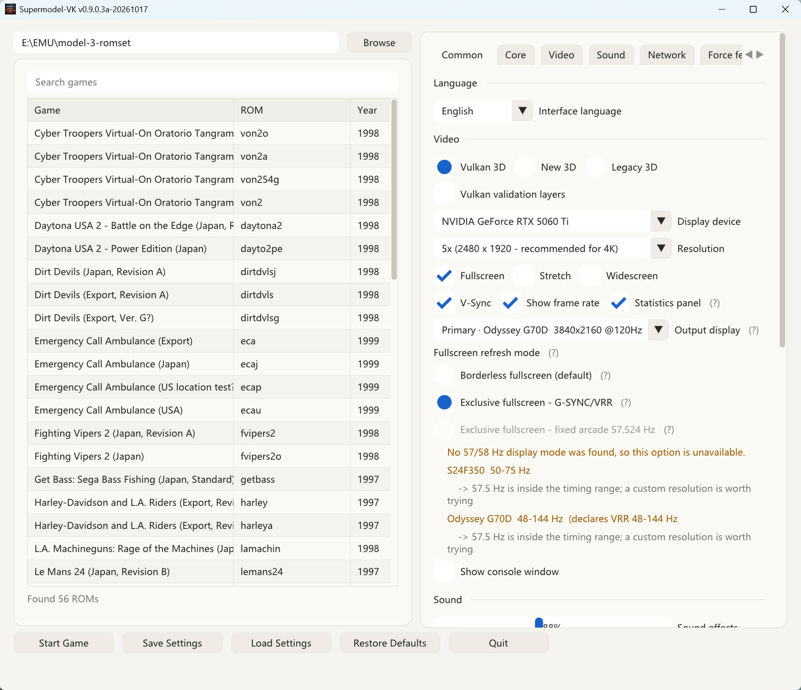
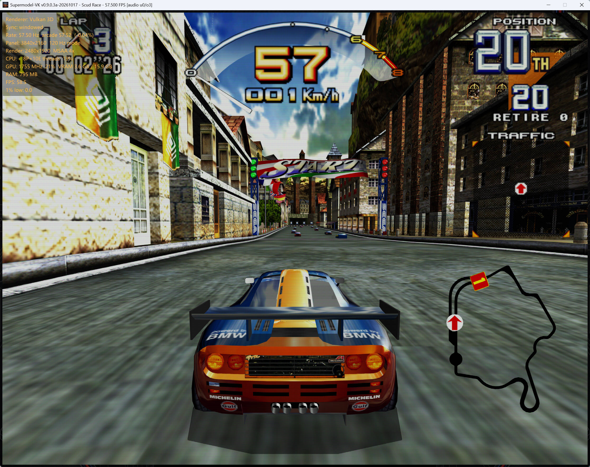
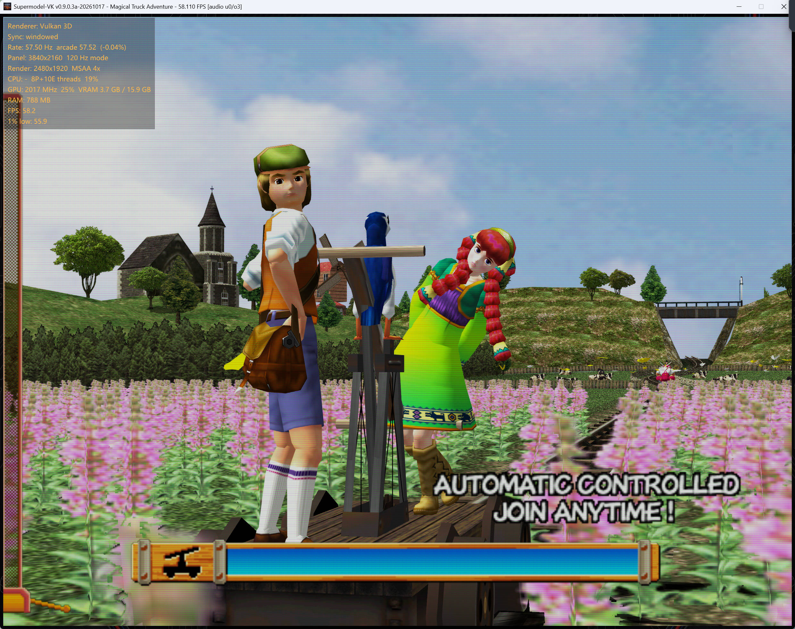

# Supermodel-VK

**A Vulkan-focused fork of [Supermodel](https://github.com/trzy/Supermodel), the open-source Sega
Model 3 arcade emulator.**

<https://github.com/Igloo-Garage/Supermodel-VK>

Version `0.9.0.3a-20261017`, based on upstream `v0.3a-20261017-git-b05ef21`.

**[Download the latest release](https://github.com/Igloo-Garage/Supermodel-VK/releases/latest)** —
unzip and run, nothing to install.

Model 3 debuted in 1996 with Virtua Fighter 3 and Scud Race, and for the three years that followed it
was the most powerful 3D hardware of any gaming platform. Developed by Real3D, then a Lockheed Martin
company, with a heritage rooted in flight-simulator technology, it could store, transform, light and
rasterise tens of thousands of polygons per frame at a fluid 57.524 frames per second. No public
documentation for the platform exists; everything known about it was reverse engineered.

---

## Download and run

No installer and no command line: download, extract, run. Grab the archive for your platform from
the [latest release](https://github.com/Igloo-Garage/Supermodel-VK/releases/latest):

| Platform | Archive | Start it with |
| --- | --- | --- |
| Windows 10/11 (64-bit) | `Supermodel-VK.v…for.Windows.zip` | double-click `supermodel.exe` |
| Linux (x86-64) | `Supermodel-VK.v…for.Linux.tar.gz` | `./supermodel` |
| macOS 11+ (universal) | `Supermodel-VK.v…for.macOS.tar.gz` | `./supermodel` |

1. Extract the archive anywhere you can write to. Keep the folder together — the executable and the
   data folders beside it are the program; there is nothing to install.
2. Start it. The settings window opens directly.
3. Use the path field at the top of the left column (or its **Browse** button) to point at the folder
   holding your ROM set `.zip` files. The game list fills in; double-click a game, or select it and
   press **Start Game**. The archive ships an empty `ROMs/` folder you can use for this.

`Esc` returns to the settings window instead of quitting. `Tab` opens the in-game quick settings.

**First-run notes**

- No game data is included. You need your own Model 3 ROM sets, one `.zip` per game.
- The build is not code-signed. If Windows SmartScreen shows "Windows protected your PC", choose
  **More info → Run anyway**.
- Vulkan is the default renderer. It needs a Vulkan 1.3 driver (1.2 with dynamic rendering and
  synchronisation2 also qualifies); otherwise the emulator falls back to OpenGL 4.1 for that
  session and says so in the settings window. On Linux, the fallback needs a working
  OpenGL driver; install `libvulkan1` and `mesa-vulkan-drivers` to use Vulkan.
- Settings, NVRAM, save states and logs stay next to the executable (`Data\` on Windows;
  `Config/`, `NVRAM/`, `Saves/`, `Screenshots/` in the extracted folder on Linux and macOS).
  Moving the executable on its own starts with fresh settings.

---

## What this fork changes

The emulation core is upstream's. The rendering and presentation layers are reworked:

**Vulkan 1.3 backend** — `Src/Graphics/Vulkan3D/`, alongside the original OpenGL renderers. Per-frame
vertex arenas are protected by fences, so long sessions do not leak or develop black patches.



**CRT post-processing** — scanlines, phosphor masks (aperture grille / slot / shadow) and glass glow,
all computed from an integrated beam profile rather than point-sampled. Point sampling beats into
broad light and dark bands at 4K; integrating over each pixel's footprint removes that dependency and
lets any scanline count render smoothly. There is no geometry or curvature option — this does not
attempt to simulate a spherical tube.





**Standalone ImGui settings window** — the settings screen is the application shell. It stays alive
for the whole run, so `Esc` returns to it instead of quitting the program, the way PCSX2 and other
emulators behave. Settings that need a fresh session say so; the rest apply immediately.

**Three exclusive sync modes** — exclusive fullscreen at a fixed 57.5242 Hz arcade rate, exclusive
fullscreen where G-SYNC/VRR tracks the emulator rate, and borderless. The statistics panel reports
which one is actually in effect and what the panel is doing, because a mode being selected and a mode
being honoured are different things.

**Decoupled multi-threaded audio** — sample generation is fractional per frame rather than rounded,
the sound board runs on its own thread, and the output buffer adapts. A non-integer ratio between
57.5242 Hz and a 60 Hz display produces a click every few seconds otherwise.

**Integer scaling that reports itself** — the multiple is derived from the panel's real resolution
(`384 × N ≤ panel rows`), never from the resolution preset, and the settings window shows the multiple
actually in effect plus the row count the next step would need. A 2160-row 4K panel reaches 5×
(2480×1920) and no further; 6× needs 2304 rows, which no 16:9 4K panel has.

**Hot-plug gamepads** — on the `sdl` and `sdlgamepad` input systems, a pad attached or detached
mid-game is picked up without restarting. The other backends still enumerate once at start-up.

**Chinese and English interface** — with the input binding table translated in both directions, since
those strings originate in English for the console and the log.

No game data is included or distributed. You need your own ROMs.

---

## Build from source

Only needed if you want to modify the code or build for a platform without a release archive.
Release users can stop after **Download and run** above.

### Fetch the libraries first

The third-party trees are deliberately not committed — they are large and are restored on demand:

```
Libraries\Get_Libs.cmd
```

This pulls SDL2, zlib, Vulkan-Headers and glslang. On Linux or macOS use the equivalent
`git clone` commands in `Libraries/DIR.txt`, or install the distribution packages.

### Windows (Visual Studio)

Open `MSVC\Supermodel.sln` and build **Release x64**, or from a developer command prompt:

```
msbuild MSVC\Supermodel.sln /m /p:Configuration=Release /p:Platform=x64
```

`build.bat` does the same and then assembles a runnable folder under `dist\`.

The project asks for the v145 toolset and falls back to the newest installed one, so Visual Studio
2022 works as well as 2026.

### Windows (MSYS2 / GCC)

After installing MSYS2:

```
pacman -S mingw64/mingw-w64-x86_64-gcc
pacman -S mingw64/mingw-w64-x86_64-make
pacman -S mingw64/mingw-w64-x86_64-SDL2
pacman -S mingw64/mingw-w64-x86_64-SDL2_net
```

Ensure `gcc` and `mingw32-make` are on your path (`/mingw64/bin` in the MSYS2 shell, or
`C:\msys64\mingw64\bin` for a normal command prompt), then:

```
mingw32-make -f Makefiles/Makefile.Win32
```

### Linux

```
sudo apt install build-essential pkg-config libsdl2-dev libsdl2-net-dev libglu1-mesa-dev zlib1g-dev
sudo apt install libvulkan1 mesa-vulkan-drivers   # runtime for the Vulkan renderer
make -f Makefiles/Makefile.UNIX
```

The binary is written to `bin/supermodel`; run it from the repository root so it picks up `Config/`
and `Assets/`. Vulkan headers are vendored under `Libraries/Vulkan-Headers`, so no Vulkan SDK is
required to build.

### macOS

```
xcode-select --install
```

Install SDL2 and SDL_net from <https://github.com/libsdl-org/SDL/releases> and
<https://github.com/libsdl-org/SDL_net/releases> into `/Library/Frameworks`, then:

```
make -f Makefiles/Makefile.OSX
```

A binary downloaded or built elsewhere needs one-time execution permission: right-click it in
Finder, choose **Open**, and confirm. See
<https://support.apple.com/guide/mac-help/open-a-mac-app-from-an-unidentified-developer-mh40616/mac>.

The macOS release is a universal binary (Apple Silicon and Intel), but it is packaged as a bare
Unix executable rather than a `.app`. Keep `supermodel` in the extracted folder next to
`Frameworks/`, open Terminal there, and run `./supermodel`. MoltenVK is bundled in `Frameworks/`,
so Vulkan 3D works without Homebrew or the Vulkan SDK; a system MoltenVK is also detected if
present. Without either, the emulator falls back to the OpenGL New 3D renderer. The bundled
MoltenVK is Apache-2.0; see `Frameworks/LICENSE-MoltenVK.txt`.

### Shaders

The Vulkan shaders are compiled to SPIR-V by `Scripts/CompileVulkanShaders.cmd` (Windows) or
`Scripts/CompileVulkanShaders.sh`. The generated `.spv.h` headers are committed, so a plain source
build does not need glslang installed; the `.spv` intermediates are not committed.

---

## Requirements

| | |
|---|---|
| OS | Windows 10/11 (64-bit), Linux, or macOS 11+ |
| Vulkan | Driver providing Vulkan 1.3, or Vulkan 1.2 with `VK_KHR_dynamic_rendering` and `VK_KHR_synchronization2` — for the Vulkan 3D renderer |
| OpenGL | Driver providing OpenGL 4.1+ — for the New 3D and Legacy 3D renderers |

Nothing else needs installing. The C++ runtime, SDL2 and SDL2_net are linked statically, so the
executable has no DLL dependencies beyond `vulkan-1.dll`, which the graphics driver provides.

---

## Version numbering

The version is written down in exactly one place, `Src/Version.h`:

```c
#define SUPERMODEL_VERSION      "0.3a-WIP"     /* upstream core; recorded in save states */
#define SUPERMODEL_FORK_VERSION "0.9.0.3a"
#define SUPERMODEL_FORK_DATE    "20261017"
```

`SUPERMODEL_TITLE_FULL` is assembled from the last two, and `build.bat` reads the same lines through
`Scripts/VersionString.ps1`. `SUPERMODEL_VERSION` is kept separate on purpose: it is stored in save
states and NVRAM, so changing it would invalidate every save a user already has.

---

## Relationship to upstream

**Taken from upstream `v0.3a-20261017-git-b05ef21`:**

- `Src/CPU/PowerPC/ppc_ops.c` — instruction-semantics fixes ported from MAME: `sraw` when
  `rA == rS`, the `subfme` carry flag, undefined behaviour in the `rlw*` rotate amounts, and
  consistent `fctiw` / `fctiwz` NaN handling across x86 and ARM.
- `Src/Graphics/New3D/R3DShaderQuads.h` and `New3D.cpp` — the QuadTriFix. A forced triangle used to
  be stored as a quad with a fabricated fourth corner, which put that corner off the real triangle
  and corrupted depth and texture coordinates across the sliver beside it. The duplicate vertex is
  now passed through and the geometry shader emits an exact triangle instead.

**Not taken:**

- **PRO-1000 machine support.** It touches `Model3`, `Real3D`, `TileGen`, `53C810`, `IEmulator` and
  `Main.cpp`, several of which this fork has modified heavily for Vulkan. It is a piece of work in
  its own right, not a file copy.
- **Upstream `Audio.cpp` / `SCSP.cpp`.** Both have diverged substantially here: this fork's versions
  carry the decoupled audio path, the adaptive output latency and the fractional sample accumulator.
  Taking upstream's would remove them.

The Vulkan renderer needs no equivalent of QuadTriFix. `CopyVertexData` splits a quad into two real
triangles (`0,1,2` and `0,2,3`) and submits them as `VK_PRIMITIVE_TOPOLOGY_TRIANGLE_LIST`, so there
is never a duplicate vertex to begin with. The defect belongs to New 3D's quad-shading approach,
which reconstructs Model 3's quad rasterisation rules in a geometry shader — more faithful to the
hardware, but with degenerate input to guard against.

---

## Documentation

- `Docs/README.txt` — the full upstream manual: every setting, every command-line option
- `Docs/README-VK.txt` — what this fork adds, in English
- `Docs/安装说明.txt` — setup guide in Chinese, including which input system to pick per controller

---

## Known limitations

- **Hot-plug applies to `sdl` and `sdlgamepad` only.** `xinput`, `dinput` and `rawinput` enumerate
  devices once at start-up; attaching a pad mid-game there still needs a session restart.
- **8BitDo pads have button-type triggers.** SDL maps L2/R2 as buttons and synthesises a full-scale
  axis value while held, so binding one to brake or throttle works but is on/off rather than
  analogue. That is the hardware, not a fault in the emulator. An SN30 Pro+ also reports itself as
  "Nintendo Switch Pro Controller" in Switch mode, which is why it must be recognised by that name.
- **The 4×, 6× and 8× resolution presets are unreachable on 16:9 panels.** They need 1536, 2304 and
  3072 rows respectively; 1440-row panels cap at 3× and 2160-row panels jump to 5×. They are kept
  for custom and non-16:9 panels, and the preset list says so.
- **Integer scaling and widescreen interact.** With `IntegerScale` on, the visible picture is shorter
  than the window, so the 3D layer is drawn into a sub-rectangle. The frustum widening accounts for
  that; scanlines do not, because they are counted against the whole frame. The scanline controls
  state both the pitch and the resulting count so the difference is visible rather than surprising.

---

## Community

Emulator questions belong in the [upstream Supermodel Discord](https://discord.gg/XDd7TMMUMz) —
that is where the people who reverse engineered the Model 3 hardware are.

## Licence

GNU General Public License v3 or later, as upstream. See `Docs/LICENSE.txt`.

A note on why there is only one licence file: GPL does not permit additional terms on a derivative
work, and the Vulkan renderer links against the emulation core, so the two form a single work under
that licence. `NOTICE.md` records what is original to this fork, how much of it there is, and the
licences of the third-party components.

Supermodel is the work of The Supermodel Team — Bart Trzynadlowski, Nik Henson, Ville Linde,
Stefano Teso and many contributors. This fork stands on their reverse-engineering of the Model 3
platform; none of it would exist otherwise. `NOTICE.md` has the full credits, the size of this fork's
additions, and how they were built.
