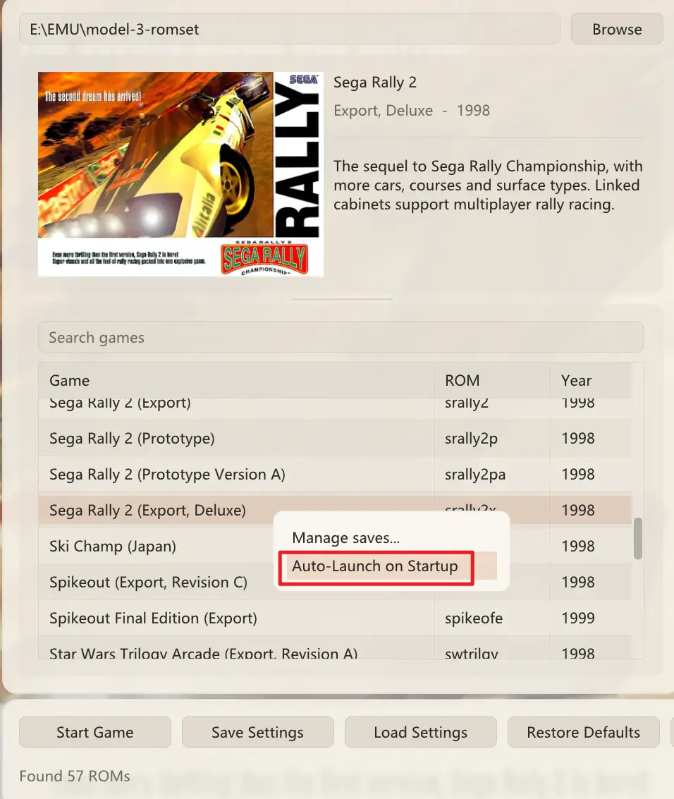
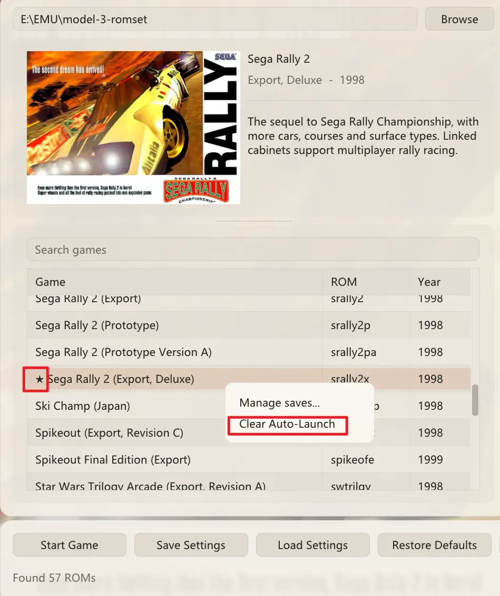

# Model 3-Vulkan Release Notes

## v0.9.9.6 (2026-11-04)

**Model 3-Vulkan v0.9.9.6** is a major feature, audio, performance, and peripheral release built on the v0.9.8.6 line. It introduces a PowerPC 603e to x86-64 hybrid JIT compiler, a complete audio pipeline upgrade (native 5.1 Surround with a smart Butterworth upmixer, a built-in lock-free multi-channel WAV/FLAC recorder, 4-tap Catmull-Rom SCSP interpolation, and direct 32-bit float DSB MPEG decoding), direct-drive steering wheel force feedback with pedal calibration, a Need for Speed-style chase camera stabilizer, and all platform hotfixes from `v0.9.8.6a` and `v0.9.8.6x`.

### 🔊 Audio Pipeline Overhaul & Multi-Channel Recording

* **Native 4.0 Quad & 5.1 Surround Output + Smart 5.1 Hardware Upmixer**
  * `NbSoundChannels` now supports **1 (Mono)**, **2 (Stereo)**, **4 (4.0 Quad `[FL, FR, RL, RR]`)**, and **6 (5.1 Surround `[FL, FR, FC, LFE, RL, RR]`)**.
  * **Smart 5.1 Upmixer (`SurroundUpmix51`, enabled by default)**: synthesizes the **Center (`FC`)** channel in real time from front/rear common-mode signals (vocals, navigator calls, and lead melodies) while feeding the **Subwoofer (`LFE`)** through a pre-warped **2nd-order Butterworth low-pass filter (< 120 Hz)** to extract deep engine rumble and collision bass.
* **Built-In Lock-Free Multi-Channel Lossless Audio Recorder (`RecordWav` / `RecordWavFormat`)**
  * Captures the raw 4.0 or 5.1 mix at the end of the mixer pipeline via a lock-free SPSC ring buffer and a dedicated background disk-writer thread (zero blocking I/O or mutex contention on the real-time SDL audio thread).
  * Keeps the full 4- or 6-channel mix active while recording even on stereo desktop endpoints (SDL3's `SDL_AudioStream` downmixes for monitoring while the file records discrete surround channels).
  * Supports four lossless formats out of the box: **WAV 32-bit IEEE Float** (`wav_float32`), **WAV 16-bit PCM** (`wav_pcm16`), **FLAC 24-bit PCM** (`flac_pcm24`), and **FLAC 16-bit PCM** (`flac_pcm16`), complete with `WAVE_FORMAT_EXTENSIBLE` / `VORBIS_COMMENT` speaker masks (`0x33` for 4.0, `0x3F` for 5.1) for Premiere, DaVinci Resolve, and Audacity.
  * Saved automatically to `Data/Recordings/Sound/<GameTitle>_YYYY-MM-DD<Day>_HH-MM-SS_<N>ch.wav/.flac`.
* **SCSP & DSB Hardware-Level Fidelity Upgrades**
  * **4-Tap Catmull-Rom Cubic Interpolation on SCSP PCM Voices**: pure PCM voices (automatically excluding FM carriers and modulators via a per-chip modulator mask) now use loop-aware 4-tap Catmull-Rom cubic spline interpolation, eliminating pitch-transposition aliasing on low-rate engine, tyre, and voice samples while keeping FM synthesis bit-exact.
  * **SCSP Accuracy Fixes**: fixed slave-SCSP FM slots reading the master SCSP's `RINGBUF`, wired Slots 16–17 `EFSDL`/`EFPAN` to `DSP.EXTS[0..1]`, implemented `LFORE` phase reset, and fixed dynamic mid-note `AR`/`D1R`/`D2R`/`RR`/`KRS` envelope rate updates.
  * **Direct 32-Bit Float DSB MPEG Decoding & Volume Ramping**: enabled `MINIMP3_FLOAT_OUTPUT` so the MPEG Layer II synthesis filter feeds the 64-tap polyphase sinc resampler directly in 32-bit float (removing intermediate `int16_t` quantization and clipping), paired with per-sample linear gain ramping to eliminate 57.5 Hz frame-boundary zipper noise during music fades.
  * **Master Bus $C^1$-Continuous Knee Soft-Clipper**: strictly bit-exact linear pass-through below `-1.41 dBFS` (`0.85`), with smooth rational saturation above the knee to prevent flat-top hard clipping when `MusicVolume > 100%` or multi-channel peaks stack.
* **Restored Looped MPEG Music Intros & Fixed Daytona USA 2 Same-Track Bug**
  * **Pre-loop intros restored**: `MpegDec` now preserves valid negative pre-loop offsets after `UpdateMemory()` moves the window to `loopStart`, restoring the 9.9-second intro of *Daytona USA 2*'s attract theme and the 12.6-second intros of its race themes.
  * **Fixed *Daytona USA 2* playing the same BGM on every course**: single-button view cycling (`VRCycle`) previously held the default `VR3` button down on every frame from boot, which triggered *Daytona USA 2*'s arcade Easter egg (holding `VR3` while a race loads forces Track 8 `AE 10 08` on all courses). View cycling now emits a 6-frame momentary button pulse only when pressed.

### ⚡ PowerPC 603e → x86-64 Hybrid JIT & Scene-Builder Optimisations

* **x86-64 Hybrid JIT (`PowerPCMode = 1` by default)**: translates hot PowerPC 603e basic blocks into native x86-64 code (backed by `PPC_FAST_MEMORY`, a 16 MB code cache, self-modifying code page tracking, and idle-loop skipping). Verified across 675 million blocks in lock-step with the interpreter with zero mismatches and pixel-identical output, delivering **~4.1× higher frame rates in CPU-bound scenes** (224.5 Hz vs 55.2 Hz).
* **Scene Builder Optimisations**: ported the Android branch's `CR3DSceneBuilder` improvements (`m_dynamicRomModels` negative caching, single-resize `CopyVertexData`, and `sqrt` distance checks) to reduce per-frame CPU overhead.

### 🏎️ Direct-Drive Wheel Force Feedback, Pedal Calibration & Chase Camera

* **Steering Wheel Force Feedback Fixed in SDL3**:
  * `SDL_INIT_HAPTIC` is now initialised before the joystick/gamepad subsystems on Windows so DirectInput wheels are enumerated by SDL's haptic backend.
  * Removed the `isGamepad` gate that blocked raw joystick wheel bases (such as SIMAGIC, MOZA, and Fanatec), fixed single-axis Cartesian constant-force sign encoding, routed `FFVibrate` through `SDL_HAPTIC_SINE` with a rumble fallback, and reset hardware autocenter so the game's own spring effect is in control.
* **Live Wheel & Pedal Axis Calibration Table + H-Shifter Auto-Neutral**:
  * Added a DPI-aware live axis calibration table on **FFB / Sensitivity** supporting centred bidirectional axes, full-travel pedals, deadzones, and custom min/max ranges (stretches to fill wide windows and scrolls horizontally when narrow).
  * Added a one-click **"Release H-shifter to neutral (from gears 1–4)"** binding generator on the **Controls** tab.
* **Need for Speed-Style Chase Camera Stabilizer & Stick Steering Sensitivity**:
  * **Chase Camera Stabilizer (`ChaseCameraStabilizer`, Off / Light / Standard / Strong, default Strong)**: applies a spring-damper yaw filter around the player car's pivot in view space so micro-corrections on a gamepad no longer whip the entire horizon and city skyline side to side, while keeping full-screen 3D HUDs (speedometer, course map, turn arrows) stationary.
  * **Gamepad Steering Sensitivity (`GamepadSteeringSensitivity`, 25%–100%, default 66%)** & retuned **Steering Smoothing** (default Strong), accessible on **FFB / Sensitivity** and live in the in-game `Tab` overlay. Selecting **Off** resets sensitivity to `100%`, and both settings automatically bypass (preserving a 1:1 direct response) whenever `InputSteering` is bound to a physical racing wheel.

### 💾 Save States, HD Texture Dumps & Cross-Platform Fixes

* **Attract-Mode Save States (`CSimNetBoard`)**: the simulated network board's state and shared RAM/buffer are now saved and restored (with a synthesized single-machine ready state and 256→848 segment-size fix for older saves), preventing attract-mode saves from timing out into the boot self-test or hanging on *"Please Wait"* when entering car select.
* **Clean HD Texture Dumps**: exported PNGs now only write the arcade's 1-bit `T1RGB5` alpha dither mask when a material actually enables alpha testing or texture alpha; opaque materials are exported with solid `255` alpha (and re-exported automatically if a later material samples alpha on the same hash), eliminating "white dots / dashed lines" in image viewers.
* **macOS Retina 4K Support**: the game window now requests a high-density drawable (`SDL_WINDOW_HIGH_PIXEL_DENSITY`) and computes render geometry in device pixels while keeping input in window coordinates, so 4K panels and integer scaling render at full native resolution under macOS default scaling.
* **Consolidated Platform Hotfixes (from `v0.9.8.6a` & `v0.9.8.6x`)**:
  * **Windows + AMD GPUs (`v0.9.8.6a`)**: moved per-viewport uniforms (`projection`, `lightDir`, `lightParams`, `fogColour`) from push constants into `ViewportUBO`, shrinking `R3DPush` from 208 B to 96 B so AMD Windows Vulkan drivers (which cap `maxPushConstantsSize` at 128 B on Radeon RX, Ryzen APUs, Steam Deck Win11, ROG Ally, and Legion Go) start normally.
  * **Linux & macOS (`v0.9.8.6x`)**: pinned Linux release builds to Ubuntu 24.04 (`GLIBC_2.38` baseline for SteamOS 3.5+ and Ubuntu 24.04), bundled `wqy-microhei.ttc` with a Latin-glyph check, enabled `<exe>/Data/` discovery on Linux, included `libdecor` for GNOME Wayland title bars, and wired non-Windows mouse/keyboard input into the in-game `Tab` overlay.
* **Build, Config & Diagnostic Log Cleanup**: retired `Supermodel-LegacyOG.exe` and `Supermodel.ini` so `Data/Config/` keeps only `Model3-Vulkan.ini` (migrating or removing stale copies and repairing moved `GameXMLFile` paths automatically), enriched `Data/Model3Vulkan.log` with build/memory/path/audio-DSP/axis-calibration telemetry, and updated Chinese game title localizations (*Spikeout* → 锐击, *Daytona USA 2* → 梦游美国 2).

Compatibility: save states and NVRAM remain compatible; `SUPERMODEL_VERSION` is untouched.

---

## v0.9.8.6m — macOS only (2026-10-30)

> **This release is for macOS only.** It contains one asset, `Model3-Vulkan.v0.9.8.6m.for.macOS.tar.gz`.
> There is no Windows or Linux build in this release, and none is needed: nothing outside the
> macOS platform layer changed since v0.9.8.6. The `m` suffix marks the macOS build of 0.9.8.6;
> the Windows and Linux builds keep the 0.9.8.6 number.

**Model 3-Vulkan v0.9.8.6m makes the macOS build start again.** v0.9.8.6 refused to launch with
"Vulkan 1.3 required" (`VkResult -7`) on every Mac that has been tried; this release fixes the
three macOS-only defects behind that message.

### Fixed (macOS)

* **Startup no longer fails with `VkResult -7`.** The preflight asked for `VK_KHR_portability_enumeration`, an extension the Vulkan *loader* synthesises. The macOS package loads MoltenVK directly through volk with no loader in between, so the request was rejected before any device was looked at. The extension is now requested only when the implementation actually lists it, and the portability flag is set together with it.
* **The preflight no longer rejects a Vulkan 1.2 device that the renderer accepts.** `ClassifyDevice()` has always allowed either Vulkan 1.3 or Vulkan 1.2 with `VK_KHR_dynamic_rendering` plus `VK_KHR_synchronization2`; the preflight only accepted 1.3, so a machine the renderer could drive was turned away at the door. Both now use the same rule.
* **The macOS package finds its own data again.** The path helper looked for `Config/` beside the executable while the archive ships `Data/Config/`, so `Games.xml`, `Boxarts/`, NVRAM and saves were all invisible. `Data/` is used when it exists; the old layout still works as a fallback. The default ROM folder is `roms/`, next to the executable.

### Known limitation on macOS 13

`.zst` save containers need **macOS 14 or newer**. The optional HostCore module is a .NET Native AOT library that links the system Swift runtime, and the Swift function it needs (`swift_getTypeByMangledNameInContext2`) first shipped in Swift 5.9, which is what macOS 14 includes. On macOS 13 the module does not load, the emulator says so once in the log and falls back to **`.st`**, which works normally — saving, F7 loading and `-load-state` were all verified on macOS 13.7.8. Nothing else is affected.

### No OpenGL build for macOS

The macOS package no longer offers the traditional OpenGL renderer. Keeping three platforms and six builds in step — Vulkan and OpenGL for Windows, Linux and macOS — is more than one person with limited hardware can keep tested, so macOS ships the Vulkan build only. `Supermodel-LegacyOG` remains available on Windows.

### Verified on hardware

macOS 13.7.8 on an Intel Core i5-8365U: the settings window opens, all 56 ROM sets in the local folder are listed and identified, Daytona USA 2 runs (bezel, textures, audio), and a `.st` save state is written and loaded back at the expected PC. The log contains no errors apart from the HostCore notice described above.

### Settings for Intel integrated graphics

On a 24-EU Intel iGPU the 3D scene is the expensive part. If a game is choppy, open **Advanced → Hardware preset** and choose **integrated graphics (992×768)** or the **ultra-low (496×384)** preset: the 3D scene is rendered at a fixed lower resolution and scaled up, while the HUD stays sharp.

Thanks to Mateus109 for the report (issue #12).

Compatibility: save states and NVRAM are unchanged; `SUPERMODEL_VERSION` is untouched. The Windows and Linux builds are unchanged since v0.9.8.6.

## v0.9.8.6 (2026-10-29)

> **Attention macOS users: download [v0.9.8.6m](https://github.com/Igloo-Garage/Model-3-Vulkan/releases/tag/v0.9.8.6m) instead — the macOS build attached to this release does not start.** The Vulkan preflight in this archive fails with `VkResult -7`, so the emulator never reaches its settings window on macOS. v0.9.8.6m is the macOS-only rebuild that fixes it; the Windows and Linux downloads on this page are unaffected and still current.

**Model 3-Vulkan v0.9.8.6** makes every hotkey configurable from the INI file, fixes input handling for mice, standalone shifters and button boxes, and adds a one-click automatic launch.

### 🎮 Input

* **Hotkeys in the INI** — every in-game hotkey is an `InputUI...` entry (`InputUIExit`, `InputUISaveState`, `InputUIToggleOverlay`, ...), so a front end such as RetroBat or a cabinet build can assign its own buttons. Chords use the normal binding syntax, e.g. `JOY1_BUTTON7+JOY1_BUTTON8`. The Controls page still neither lists nor rewrites these keys, so editing the interface - or pressing **Apply recommended bindings** - never clobbers what a front end wrote; a key left out keeps the built-in default and `NONE` disables one. The two-line patch was proposed by **Tartifless** over at RetroBat (RetroBat-Official/emulatorlauncher#1456) and is included as-is.
* **Binding a mouse axis works again** — a full-axis capture compared the pointer against the display centre and could keep both X and Y, producing `MOUSE_XAXIS+MOUSE_YAXIS`, which the input system rejects as an invalid combination; the capture then silently failed. Only the dominant axis (the larger displacement) is captured now, and a capture in progress no longer appends a second axis when the pointer or a resting pedal crosses the centre, so a full-axis binding always ends up as exactly one source.
* **Standalone shifters, handbrakes and >16-button devices work in the default input mode** — with `sdlgamepad` selected, SDL3 devices that do not identify as game controllers used to be skipped, so a MOZA H-shifter or a handbrake could not be bound at all. They are opened alongside the controllers now, `BUTTON17` and up are readable on any device, and standard pads keep exactly the button numbering they had.
* **The control-preset combo stays on what you picked** — selecting "Keyboard only" was replaced on the next frame by the value still in the INI.

### 🖥️ Interface

* **Auto-Launch on Startup** — right-click a row in the game list and choose it to start that game automatically the next time the program opens. The row is marked with `★`; **Clear Auto-Launch** on the same row undoes it. It fires once per run, so pressing `Esc` returns to the list rather than restarting the game, and starting with a ROM set on the command line is unaffected because that path never opens the list. Three rough edges found while testing that path are fixed too: the key no longer shows up as a stray untranslated text box on the Core page, launching straight into a starred game no longer flashes the settings window, and the menu entry is greyed out for sets that cannot start instead of silently doing nothing.

  

    
    
  

Compatibility: save states and NVRAM are unchanged; `SUPERMODEL_VERSION` is untouched.

## v0.9.8.3b Maintenance Release (2026-10-28)

**Model 3-Vulkan v0.9.8.3b** is a maintenance update for the v0.9.8.3a milestone. It fixes a regression that silenced sound effects in every title and completes the native DDS path for HD texture packs.

### 🔧 Fixes

* **Sound effects restored in every game.** A misplaced `else` in `CSoundBoard::RunFrame()` cleared the SCSP output buffers immediately after the sound board filled them, so only the MPEG music survived. Engine, tyre, collision and menu effects were silent on fresh boots and on loaded saves alike; they are back now. Music playback, the quad-to-stereo fold and existing save states are unaffected.

### 🖼️ HD Texture Packs

* **`.dds` / `.dds.zst` support** — BC1, BC2, BC3, BC5 and BC7 images go straight into VRAM with the mip chain from the file (no blit pass). Files are uploaded in resumable chunks, so a 4096×4096 BC7 chain no longer starves the staging ring.
* **Pack order is `.dds.zst` > `.dds` > `.webp` > `.png`** when several files carry the same hash.
* **F4 toggles replacements and F3 rescans the folder**, so a pack can be compared against the original artwork without opening the in-game panel.

### 🛠️ Under the hood

* `SM3D_AUDIO_LEVEL=1` now reports the source peak split into front and rear channels, which makes "the machine is playing but one channel is missing" visible in the log.
* The 3D scene targets are handed to the 2D compositor on every exit path (including the white-flash frame), and new targets are transitioned before the first composite, so `VUID-vkCmdDraw-imageLayout-00344` no longer appears after a flash frame.
* A same-layout write-after-write barrier was added for attachments cleared at the start of a scene pass, closing a cross-submit hazard visible to synchronisation validation.

Compatibility: save states written by v0.9.8.3a (and by the Supermodel-VK fork) load unchanged; `SUPERMODEL_VERSION` is untouched.

## v0.9.8.3a Milestone Release (2026-10-28)

**Model 3-Vulkan v0.9.8.3a** represents a historic architectural milestone in Sega Model 3 emulation. This release officially graduates the project from **Supermodel-VK** into **Model 3-Vulkan**, decoupling the modern rendering pipeline from legacy OpenGL into a dedicated, high-performance Vulkan 1.3 architecture.

---

### 🌟 Executive Summary

* **Project Graduation**: Transitioned to an independent, standalone Vulkan 1.3 and SDL3 architecture. Legacy OpenGL is cleanly preserved as a standalone fallback binary (`Supermodel-LegacyOG.exe`).
* **Real3D Hardware Simulation**: Completely resolved long-standing graphics artifacts, including Real3D hardware-accurate checkerboard transparency (Mode 2) and Quad pull-model SSBOs.
* **Native HD Texture Pack Engine**: Unlocked the first-ever native texture replacement pipeline for Sega Model 3 arcade games with automatic hardware Mipmaps and `textureGrad` bypass.
* **Audio Overhaul**: Decoupled the sound emulation into a dedicated real-time thread, permanently retiring the 6-year-old `LegacySoundDSP` workaround by correcting SCSP memory mapping.
* **Modern Storage & State Management**: Introduced visual 16-slot save state management with Zstandard (`.zst`) compression, slashing save state file sizes by ~83% (crucial for handhelds like the Steam Deck).
* **Display Pacing & Low-Latency Input**: Native 57.524 Hz arcade refresh rate with 120Hz/144Hz+ motion interpolation via `CDisplayPacer`, backed by an ultra-low latency SDL3 Raw Input and HIDAPI input foundation.

---

### 🎨 Visuals & Real3D Emulation Accuracy

#### 1. 100% Hardware Quad Pull-Model (SSBO)
* Completely eliminated geometry shaders. Quads are now pulled directly from shader storage buffer objects (SSBOs).
* Implemented an inverse-bilinear solver directly within the fragment shader to recover perspective-correct `(s, t)` coordinates and native quad interpolation.
* Preserves GPU Early-Z depth culling across all modern graphics pipelines, significantly boosting fill-rate efficiency on integrated and discrete GPUs alike.

#### 2. 4x EWA Anisotropic Filtering
* Engineered an elliptical weighted average (EWA) anisotropic filtering pipeline using a 2×2 Gram matrix eigenvalue extraction with dynamic tap calculation.
* Eliminates oblique texture shimmering and cross-seam edge bleeding along track boundaries and distant geometry.

#### 3. Groundbreaking 3-Tier Transparency Architecture
* **Mode 0: Bit-Exact Two-Pass (`AlphaSortMode = 0`)**:
  * Utilizes on-chip `subpassLoad` with `VK_ATTACHMENT_STORE_OP_DONT_CARE` tile memory access for optimal bandwidth efficiency on low-power and integrated GPUs.
* **Mode 1: Per-Pixel Sorted A-Buffer OIT (`AlphaSortMode = 1`)**:
  * Employs a 4-slot structure-of-arrays (SoA) A-Buffer backed by a 5-step constant-time sorting network (<0.75ms resolve at 4K MSAA).
* **Mode 2: Arcade Hardware Checkerboard (`AlphaSortMode = 2` — *World First*)**:
  * Faithfully revives Real3D’s 1996 single-pass 50% stipple dither mask and transparent Z-write depth competition.
  * **Fixes Blinding Exhaust & Tire Burnout Smoke**: Multi-layered smoke particles in *Daytona USA 2* and *Scud Race* no longer stack exponentially into solid, blinding white walls of milk; they now render with authentic arcade depth, proper particle layering, and natural falloff.
  * **Fixes Sega Rally 2 Blizzard Blowout**: Permanently resolves the 20-year-old snow/fog overexposure bug where player cars were swallowed into solid white voids.
  * **Eliminates Dirty Foliage Halos**: Cleans up black outlines and alpha blending seams on 3D trees and leaves in *The Lost World: Jurassic Park*.
  * *Note:* This is an experimental mode intended for dense snow, dust and fog; it cannot reproduce LOD cross-fades. Use Mode 0 or Mode 1 for scenes such as Daytona 2's waterfall.

#### 4. CRT Filter Refinement & Evolution Roadmap
* Beam-profile scanline integration eliminates moiré banding and brightness unevenness at 4K without requiring point-sampling approximations.
* *Roadmap Goal:* The internal CRT shader pipeline will continue to be optimized, aiming to rival leading heavyweight modern retro shaders out of the box with near-zero performance cost.

---

### 🖼️ Native HD Texture Pack Engine

* **Clean Sub-Texture Identification**: Real3D sub-textures are cleanly identified and dumped using a 64-bit coordinate and format hash `(page, x, y, w, h, format)`.
* **Zero Seam Bleeding**: Automatic hardware Mipmap generation combined with `textureGrad` bypass prevents edge bleeding and mipmap shimmer across multi-quad models.
* **Format Support**:
  * Native `.png` (lossless masters)
  * Native `.webp` (ultra-compact distribution sizes with full alpha channel support)
  * Hardware-direct **`.dds` (BC7 direct VRAM streaming)** is actively in development.
* **Modder-Centric Architecture**: Designed to be extensible for community upscalers and artists. Support for custom PBR material maps (normals, roughness, metallic) and emissive layers is planned based on community creator requests.

---

### 🔊 Audio Modernization & Sound Board Decoupling

* **Dedicated Real-Time Audio Threading**:
  * Decoupled Motorola 68000 CPU and SCSP/DSB sound emulation into an independent real-time audio thread.
  * Window movements, resizing, asset streaming, or background GPU frame pacing fluctuations will no longer cause audio stutter, crackle, or dropouts.
* **The "LegacySoundDSP" Mystery Solved**:
  * Fixed an architectural flaw dating back to 2020 where address range `0x7C0–0x7FF` (a reserved hardware hole) was incorrectly mapped as a mirror of `MADRS`.
  * Because *Fighting Vipers 2* uploads its DSP image sequentially with 32 zeros filling this hole, the emulator was inadvertently zeroing out the game's newly uploaded delay/offset table, causing an acoustic positive feedback runaway loop (cutting victory speech to "you wi…" followed by a 0dB screech).
  * Discarded writes to the reserved hole, corrected effect return volume to `EFSDL << 13`, patched an unsigned underflow in `SCSP_w32`, and **officially retired the `LegacySoundDSP` switch**.
  * Restores pristine, authentic audio to *Fighting Vipers 2*, *Virtua Fighter 3*, and *Sega Rally 2* out of the box with zero configuration hacks.

---

### 💾 Modern Save State Management (`.zst`)

* **16 Visual Slots per Game**:
  * Fully accessible via right-click on the game list or directly through the in-game overlay menu (`Tab`).
  * Each slot captures a high-resolution screenshot thumbnail for effortless visual identification.
* **Zstandard (`.zst`) Compression**:
  * Upgraded state serialization to use modern Zstd compression.
  * Slashes save file size to **roughly 1/6th of legacy uncompressed `.st` files** (reducing 30–50MB+ dumps down to 4–7MB). Eliminates storage bloat and flash-memory write wear on handheld devices like the **Steam Deck**.
* *Usage Pro-Tip:* For select titles with complex mid-stage memory transitions, restoring save states via the in-game quick menu (`Tab`) is recommended over desktop launcher cold-booting.

---

### 🖥️ UI, Multi-Monitor & Display Pacing

* **Intelligent Window Lifecycle & Dynamic DPI**:
  * Window dimensions are preserved seamlessly between sessions.
  * Moving the emulator window between primary and secondary monitors with differing screen resolutions or OS scaling factors (e.g., 4K 150% to 1080p 100%) dynamically updates without blurry text or cropped controls.
* **Warm Eye-Care Themes**:
  * Introduced three built-in visual styles (warm light, warm dark, and the original interface), with a custom **Warm Eye-Care Theme** active by default to filter blue-white glare during extended sessions.
  * Public community theming API planned for future releases.
* **Arcade-Exact 57.524 Hz Pacing (`CDisplayPacer`)**:
  * Delivers exact 57.524 Hz arcade refresh rate on VRR/G-Sync monitors.
  * Provides smooth, motion-interpolated presentation on 120Hz, 144Hz, and 240Hz high-refresh displays.
* **SDL3 Ultra-Low Latency Input Foundation**:
  * Fully migrated the Vulkan build to SDL3 input handling, retiring the legacy DirectInput and XInput backend split.
  * SDL3 gamepad handling uses HIDAPI polling, and a dedicated RawInput path provides isolated per-device mouse tracking for dual light guns. Hot-plugging is automatic.

---

### 🛠️ Additional Fixes in This Build

* **Scud Race save states (`scudplus.zst1`)**: Loading a car-select save no longer hangs. The saved MPEG window is validated (the `0x80008000` "no track" sentinel is rejected), a stalled decoder exits with silence instead of spinning, and the sound board re-drives its interrupt line on load, so effects work after restoring a state. New saves also carry a companion MPEG block, so background music resumes from the saved position; states written by older builds return the music when the game issues its next track command.
* **Quad-cabinet audio on stereo endpoints**: The mixer now reads the output device's real channel count. On a two-channel device the rear pair is folded into the front pair by the mixer itself, instead of SDL applying a different downmix while the statistics panel still reported four channels. This restores Scud Race's car-select effects and rear-channel sound effects on normal desktop speakers.
* **Input system default**: The Vulkan build now defaults to **SDL Gamepad** (`sdlgamepad`); legacy `xinput` values are migrated in memory, and controller detection only suggests a backend that actually exists in this build.
* **Low-resolution 3D rendering**: **Video → Picture scaling** now also offers **992×768 (2× native)** beside 496×384. The 3D scene renders at 992×768 and is upscaled onto the picture rectangle, while the 2D HUD keeps its own resolution. Takes effect next session.

---

### ⚙️ Dual-Binary Deployment

To ensure 100% hardware coverage, release archives provide two pre-compiled binaries:

1. **`Model3-Vulkan.exe` (Default)**:
   * Pure Vulkan 1.3 / SDL3 modern pipeline.
   * Optimized for modern dedicated GPUs (NVIDIA GeForce, AMD Radeon, Intel Arc) and Intel Iris Xe (Gen12+) integrated graphics. Older iGPUs such as Skylake and the HD 500 class should use the OpenGL fallback.
2. **`Supermodel-LegacyOG.exe` (Fallback)**:
   * Standalone SDL2 + OpenGL 4.1 legacy build.
   * Preserves compatibility for legacy hardware lacking modern Vulkan drivers (such as Intel 4th Gen Haswell).

---

### 🚀 Upcoming Milestones: Roadmap Preview

#### Part 1: Modern Peripherals Overhaul
* Plug-and-play DirectDrive and belt/gear Force Feedback telemetry for Fanatec, Moza, Simagic, Thrustmaster, and Logitech wheels.
* Native dual-lightgun support with off-screen reload detection for **Sinden, Gun4IR, Aimtrak, and Wiimote** hardware.
* Crowdsourced **Device Probe Tool** to capture community rig telemetry and generate native auto-mapping presets.

#### Part 2: Netplay 2.0
* Zero-config P2P online multiplayer via 6-digit room codes with automatic NAT punch-through.
* Asynchronous Star-Mesh UDP architecture: local simulation remains locked at 57.524 Hz / 120 Hz+ regardless of network latency.
* Drop-in / drop-out fault tolerance: disconnected racers safely coast to the roadside without crashing the active lobby.

---

### 🔗 Links & Community

* **GitHub Repository:** [https://github.com/Igloo-Garage/Model-3-Vulkan](https://github.com/Igloo-Garage/Model-3-Vulkan)
* **Subreddit:** [r/Model3Vulkan](https://www.reddit.com/r/Model3Vulkan/)
* **Support the Project:** [Ko-fi](https://ko-fi.com/igloogarage)
