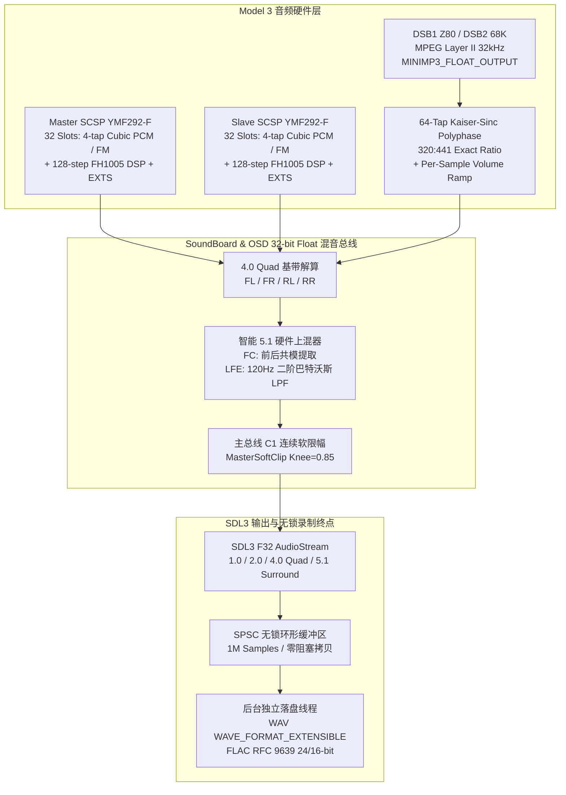

# Model 3-Vulkan 音频系统深度修复与高保真升级手册 (`runbook_sound_fix.md`)

> 本文档完整记录 Model 3-Vulkan 音频子系统（双 Yamaha YMF292-F SCSP + Z80/68K DSB1/DSB2 MPEG 子板 + SDL3 多声道管线）的架构设计、硬件级缺陷修复、DSP 音质压榨方案与经典疑难杂症排错实录，供后续维护或向其他街机模拟器移植时直接复用。

---

## 一、 音频全链路架构总览

### 涉及核心源文件

| 模块 | 路径 | 职责 |
| :--- | :--- | :--- |
| **YMF292-F SCSP 芯片核心** | `Src/Sound/SCSP.cpp`、`SCSP.h` | 双 SCSP 64 通道 PCM/FM 合成、包络发生器 (EG)、LFO (`SCSPLFO.cpp`)、18 路效果混音 |
| **FH1005 128 步 DSP** | `Src/Sound/SCSPDSP.cpp`、`SCSPDSP.h` | 24-bit 定点 / 16-bit 浮点 (`PACK`/`UNPACK`) 混响微程序执行、`0x7C0-0x7FF` 空洞保护 |
| **DSB1 / DSB2 数字音乐板** | `Src/Model3/DSB.cpp`、`DSB.h` | Z80 (DSB1) / 68K (DSB2) 控制 CPU、64-tap 320:441 多相重采样、逐样本音量斜坡 |
| **MPEG Layer II 浮点解码** | `Src/Sound/MPEG/MpegAudio.cpp`、`MpegAudio.h` | 基于 `minimp3` (`MINIMP3_FLOAT_OUTPUT`) 的 32-bit Float 解码与负偏移前奏窗口管理 |
| **音效板帧调度** | `Src/Model3/SoundBoard.cpp` | 57.524160 Hz 帧样本累加同步、SCSP 与 DSB 浮点叠加 |
| **REXABYTE 独立高保真 DSP 算子库** | `Src/Sound/IglooAudioDSP.h` | 零依赖双许可独立头：`MasterSoftClip`、`ButterworthBiquadLPF`、`UpmixQuadTo51`、`CubicInterpolate4Tap`、`LinearGainRamper` |
| **REXABYTE 独立无锁多声道录制引擎** | `Src/Sound/IglooMultiChannelRecorder.h` | 零依赖双许可独立头：`MultiChannelRecorder<SampleT>`（SPSC 无锁缓冲 + WAV Extensible + RFC 9639 FLAC 编码器） |
| **SDL3 多声道输出与录制器桥接** | `Src/OSD/SDL/Audio.cpp`、`Src/OSD/Audio.h` | 1/2/4/6 声道交错、调用 `Igloo::AudioDSP` 与 `Igloo::Audio::MultiChannelRecorder` |
| **VR 视角输入脉冲控制** | `Src/Inputs/Inputs.cpp`、`Inputs.h` | 修复 `VRCycle` 常驻按死 `VR3` 触发《Daytona USA 2》隐藏选歌秘技的缺陷 |

---

## 二、 原生 4.0 / 5.1 物理多声道输出与智能 5.1 上混器

### 1. 声道数与硬件握手 (`NbSoundChannels = 1 / 2 / 4 / 6`)
- Model 3 街机座舱天然采用四声道设计（前声道 `SCSP1/CN8 + DSB` 接前方主音箱，后声道 `SCSP2/CN7` 接座椅头枕 Gullbox 环绕音箱）。
- 在 `OpenAudio()` 中通过 `SDL_GetAudioDeviceFormat()` 查询物理声卡真实声道数：
  - **6 声道（5.1 Surround）**：物理设备支持 $\ge 6$ 声道（或已开启多声道音频录制 `RecordWav=1`）时，按 Windows `WAVE_FORMAT_EXTENSIBLE` / SDL3 标准顺序交错输出 **`[FL, FR, FC, LFE, RL, RR]`**。
  - **4 声道（4.0 Quad）**：按 **`[FL, FR, RL, RR]`** 交错输出。
  - **2 声道（立体声自动折叠）**：当物理端点只有 2 声道且未开启多声道录制时，由 `MixChannels()` 自行将后置声道等权折叠进前置声道（避免交给 SDL `SDL_ConvertQuadToStereo` 造成后声道衰减过多，解决 *Scud Race* 选车画面与座舱音效过轻的问题）。
- **栈缓冲区安全边界**：`OutputAudio()` 内的混音栈缓冲按 `MAX_HOST_CHANNELS (6) * maxFrameSamples` 分配，防止 6 声道模式下越界破坏栈帧。

### 2. 智能 5.1 硬件上混器 (`SurroundUpmix51`)
当 `NbSoundChannels = 6` 且开启 `SurroundUpmix51`（默认开启）时，在 `MixChannels()` 内实时从校准后的四声道 `(fl, fr, rl, rr)` 合成中置（`FC`）与低音炮（`LFE`）：
1. **Center (`FC`) 共模人声/领航员提取**：
   $$\text{frontMid} = 0.5 \times (\text{fl} + \text{fr}), \quad \text{rearMid} = 0.5 \times (\text{rl} + \text{rr})$$
   $$\text{fc} = 0.70710678 \times \text{frontMid} + 0.25 \times \text{rearMid}$$
   同时从前左/前右适度扣除 $0.25 \times \text{frontMid}$，避免前置声场与中置声道叠加后产生中频能量堆积（Center Build-up）。
2. **LFE (`< 120 Hz`) 二阶巴特沃斯低通滤波器 (`ButterworthBiquadLPF`)**：
   - 采用双线性变换（Bilinear Transform）预畸变设计二阶巴特沃斯低通滤波器（$f_s = 44100\text{ Hz},\ f_c = 120\text{ Hz},\ Q = 1/\sqrt{2}$），Direct Form II Transposed 实现：
     $$K = \tan\left(\frac{\pi f_c}{f_s}\right), \quad \text{norm} = \frac{1}{1 + \sqrt{2}K + K^2}$$
     $$b_0 = K^2 \cdot \text{norm}, \quad b_1 = 2b_0, \quad b_2 = b_0$$
     $$a_1 = 2(K^2 - 1)\cdot \text{norm}, \quad a_2 = (1 - \sqrt{2}K + K^2)\cdot \text{norm}$$
   - 实测《Daytona USA 2》5.1 录音中，`LFE` 声道在 `< 150 Hz` 频段的能量占比达 **93.7%**，高频被干净滤除，引擎轰鸣与碰撞重低音扎实饱满。

---

## 三、 内置无锁多声道 WAV / FLAC 无损录制器 (`MultiChannelWavRecorder`)

### 1. 为什么 WAV 提供 `Float32 / PCM16`，而 FLAC 提供 `PCM24 / PCM16`？
- **WAV (`WAVE_FORMAT_EXTENSIBLE`)**：规范支持 **32-bit IEEE Float**（`KSDATAFORMAT_SUBTYPE_IEEE_FLOAT`）与 **16-bit PCM**（`KSDATAFORMAT_SUBTYPE_PCM`）。
- **FLAC（RFC 9639 标准规范）**：FLAC 标准算法基于**纯整型线性预测 + Rice 熵编码**，规范中不存在 IEEE Float32 模式（仅定义 4~32 bit 有符号整型 PCM）。因此界面直接提供 4 档合法组合：
  1. `wav_float32`：`WAV · 32-bit IEEE Float（无损浮点）`
  2. `wav_pcm16`：`WAV · 16-bit PCM（标准整型）`
  3. `flac_pcm24`：`FLAC · 24-bit PCM（无损压缩，高动态）`
  4. `flac_pcm16`：`FLAC · 16-bit PCM（无损压缩，小体积）`

### 2. 无锁 SPSC 环形缓冲与后台落盘线程
- **实时音频回调线程零阻塞**：`AudioOut::Write()` / `AudioOut::Silence()` 仅通过 `std::memory_order_acquire` / `std::memory_order_release` 将交错后的样本写入容量为 $2^{20}$ 个 `AudioSample`（4 MB）的 SPSC 环形缓冲区，随后不持锁调用 `m_wakeCv.notify_one()`，**严禁在音频回调线程中执行任何 `fwrite` 或互斥锁等待**。
- **声道掩码 (`dwChannelMask`)**：
  - 4.0 Quad：`0x00000033` (`SPEAKER_FRONT_LEFT | SPEAKER_FRONT_RIGHT | SPEAKER_BACK_LEFT | SPEAKER_BACK_RIGHT`)
  - 5.1 Surround：`0x0000003F` (`SPEAKER_FRONT_LEFT | SPEAKER_FRONT_RIGHT | SPEAKER_FRONT_CENTER | SPEAKER_LOW_FREQUENCY | SPEAKER_BACK_LEFT | SPEAKER_BACK_RIGHT`)
  - WAV 写入 68 字节 `WAVE_FORMAT_EXTENSIBLE` 头；FLAC 写入 `STREAMINFO` + 含 `WAVEFORMATEXTENSIBLE_CHANNEL_MASK=0x0033/0x003F` 的 `VORBIS_COMMENT` 块，Premiere / DaVinci Resolve / Audacity / FFmpeg 可自动拆出全部独立声道轨。
- **保存路径与文件命名**：
  - 自动保存在 `Data/Recordings/Sound/`（`FileSystemPath::RecordingsSound`）。
  - 命名格式：`<英文游戏名>_YYYY-MM-DD<星期三字母缩写>_HH-MM-SS_<N>ch.wav/.flac`（例如：`Daytona USA 2 - Power Edition_2026-11-04Wed_09-24-39_6ch.flac`）。

### 3. 踩坑记录：FLAC 帧头同步字 `0xFFF8` 位数错位导致无法播放
- **症状**：录制出的 `.flac` 文件 `ffprobe` 能正确识别 `Duration: 00:02:35.92, 44100 Hz, 5.1, s32 (24 bit)`，但任何播放器都无法播放，`ffmpeg` 解码输出 `0 KiB`。
- **根因**：FLAC 音频帧头的 14-bit 同步码是 `11111111111110b`（`0x3FFE`），加上 1-bit reserved (`0`) 和 1-bit blockingStrategy (`0`) 共 **16 bits = `0xFFF8`**。初版误写成了 `PutBits(0x3FF8u, 15)` + `PutBits(0, 1)`，少算了最高位 1，导致每帧开头变成 `0x7FF0` 而非 `0xFFF8`，解码器读完文件头 `STREAMINFO` 后找不到任何一帧的同步字。
- **修法**：直接写入 16-bit `m_frameBw.PutBits(0xFFF8u, 16);`，经 `ffmpeg -v error` 逐帧校验 0 错误。

---

## 四、 YMF292-F (SCSP) 与 DSB 硬件还原度深度升级

### 1. SCSP 纯 PCM 通道升级为 4-tap Catmull-Rom Cubic 样条插值 (`Src/Sound/SCSP.cpp`)
- **瓶颈**：原 `SCSP_UpdateSlot()` 对所有通道仅做 2-tap 线性插值，低采样率引擎/轮胎/语音采样在大幅变调（`OCT`/`FNS`）时高频混叠明显。
- **为什么不能无脑对所有 Slot 开立方插值？**
  - YMF292-F 支持通过 64 项 `RINGBUF`（`MDL`、`MDXSL`、`MDYSL`）进行 FM 相位调制。若改变了 FM 调制器（Modulator）或载波（Carrier）的采样插值曲线，会导致 FM 合成音色（如 *Virtua Fighter 3* 的合成音效）失真。
- **精准隔离方案**：
  1. 每帧开始时扫描各芯片活动 Slot，构建 32-bit 调制器掩码 `modMask`：若某 Slot 的 `MDL != 0 || MDXSL != 0 || MDYSL != 0`，将其引用的 `(sl + MDXSL) & 31` 与 `(sl + MDYSL) & 31` 标记为 FM 调制源。
  2. 在 `SCSP_UpdateSlot()` 中，仅当 `!isFmCarrier && !isFmModulator` 时走 **4-tap Catmull-Rom Cubic 样条插值**（`CubicInterpolate4Tap`），且 `FetchSlotSample()` 严格遵守 `LSA`/`LEA` 与 `LPCTL` 循环回绕边界及 `0x7FFFF` RAM 掩码；FM 通道则保持原始 2-tap 路径。

### 2. SCSP 跨芯片 FM 与寄存器完整性修复 (`Src/Sound/SCSP.cpp`)
- **从芯片 FM 跨芯片读错 `RINGBUF`**：原 `SCSP_UpdateSlot` 第 1370 行写死了 `SCSPs->RINGBUF[(SCSPs->BUFPTR + ...)]`（永远读主芯片 `SCSPs[0]`），导致从芯片 `SCSPs[1]` 运行 FM 时读了主芯片的波形缓冲。已修正为 `SCSP->RINGBUF[(SCSP->BUFPTR + ...)]` 并在 `SCSP_DoMasterSamples()` 中逐芯片切换 `SCSP = &SCSPs[0/1]`。
- **从芯片初始化遗漏**：补齐 `SCSP_Init()` 中 `SCSPs[1].Slots[i].slot = i` 与 `SCSPs[1].SCSPRAM_LENGTH` 的初始化；修复 `SCSP_Deinit()` 中 `free(SCSPs[0].MIXBuf)` 因 `SCSP` 指针停在 `SCSPs+1` 导致的泄漏风险。
- **动态包络速率重算与 `LFORE` 复位**：在 `SCSP_UpdateSlotReg()` 中，当 68K 在音符播放中途修改 `0x08..0x0B`（`AR/D1R/D2R/RR/DL/KRS`）或 `0x10..0x11`（`OCT/FNS`）时，按真实 `octave + 2*KRS` 动态重算包络步进率（修复原 `case 0xA` 把 `rate` 传成死值 `0` 的 bug）；当 `0x12..0x13` 的 `LFORE` 置位时将 `PLFO.phase` 和 `ALFO.phase` 归零。
- **补齐第 17、18 路 Effect 通道 (`EXTS[0..1]`)**：在 `SCSP_DoMasterSamples()` 末尾补上 `Slots[16..17]` 的 `EFSDL`/`EFPAN` 对 `DSP.EXTS[0..1]` 的直通混音。

### 3. DSB MPEG Layer II 32-bit Float 无损直通 + 逐样本音量斜坡 (`MpegAudio.cpp`, `DSB.cpp`)
- **消除 `int16_t` 中间截断**：在 `MpegAudio.cpp` 启用 `#define MINIMP3_FLOAT_OUTPUT`，新增 `MpegDec::DecodeAudioFloat()` 将 `minimp3` 多相综合滤波器的浮点输出直接乘以 `32768.0f` 送入 `CDSBResampler::UpSampleAndMix(float *outL, float *outR, float *inL, float *inR, ...)`，消除原 `float -> int16_t -> float` 的二次量化与过早硬削波。
- **消除硬件音量阶跃 Zipper Noise**：在 `CDSBResampler` 内维护 `m_smoothedGainL/R`，在每帧 `sizeOut`（766/767 个样本）内对目标音量执行**逐样本线性增益斜坡（Per-sample Linear Gain Ramp）**，彻底消除曲目淡出或切歌时 57.5 Hz 帧边界的阶跃咔哒声。

### 4. 主总线 $C^1$ 连续无损膝点软限幅器 (`MasterSoftClip` in `Audio.cpp`)
- 在 `ToHostSample()` 中，对 $|x| \le 0.85$（$-1.41\text{ dBFS}$）范围内的信号保持 **100% 比特级线性直通（$y = x$，零谐波染色）**；
- 当多通道叠加或用户调高音量（如 `MusicVolume = 150%`）使瞬态峰值超过 $0.85$ 时，使用一阶导数连续的有理数软饱和曲线渐近收敛至 $\pm 1.0$：
  $$f(x) = \text{sign}(x) \cdot \left( T + (1 - T) \cdot \frac{u}{1 + u} \right), \quad u = \frac{|x| - T}{1 - T}, \quad T = 0.85$$
  彻底杜绝了此前的平顶硬截断（Hard Clip）破音，且因在拐点处函数值与一阶导数均连续（$f(T)=T,\ f'(T)=1$），绝不会产生拐点跳变咔哒声。

---

## 五、 经典疑难杂症排错实录

### 案例 A：《Daytona USA 2》所有赛道发车后背景音乐全都变成同一首歌 (`AE 10 08`)
- **症状**：无论是进初级环形赛道、中级海盗船赛道、高级摩天楼赛道还是混合长赛道，车一发动出发，播放的永远是同一首 BGM（`0x8DF436`）。起初怀疑是 `MpegDec` 负偏移前奏修复写坏了曲目指针。
- **排查过程**：
  1. 解压对比存档 `dayto2pe.zst12`（初级赛道）与 `dayto2pe.zst15`（中级海盗船赛道）中的 `DSB2` 块与 68K RAM（`0xF00000` 命令缓冲），发现**并不是解码器读错偏移，而是主板 PowerPC 游戏程序自己在发车时主动向 DSB2 发送了相同的 MIDI 播放命令 `AE 10 08`（Track 8）**！
  2. 反汇编 DSB2 68K 固件 `epr-20886.ic2`（`0x8008` 曲目表）确认：`AE 10 02` 是初级赛道曲、`AE 10 03` 是中级赛道曲、`AE 10 04` 是高级赛道曲，而 `AE 10 08` 是隐藏曲目。
  3. 追查为什么游戏主程序在所有赛道都发 `AE 10 08`：《Daytona USA 2》街机原版有一个官方隐藏选曲彩蛋——**在选完车进入赛道加载时，如果一直按住某个 `VR` 视角键不放（Hold VR1~VR4），游戏就会强制把本局 BGM 替换成该 VR 键对应的固定曲目**（按住 `VR3` 黄键正好对应 `AE 10 08`）！
  4. 检查 `Src/Inputs/Inputs.cpp` 的 `CInputs::IsVRSelected(int index)`：当开启「单键循环切换视角」（`VRCycle = 1`，默认开启，且默认 `VRDefaultView = 2` 即 `VR3`）时，旧代码写成了 `if (m_vrCycle) return index == m_vrCycleIndex;`，导致 **`VR3` 键从开机第 1 帧起每一秒钟都处于“被玩家死死按住不松手”的状态**，100% 触发了隐藏选曲秘技！
- **修法**：街机面板上的 VR1~VR4 是**瞬时微动按钮（Momentary Push Button）**，切视角只需按一下即松开。在 `CInputs` 中引入 `m_vrPulseFrames` 脉冲计数器：开局及选车期间不按住任何 VR 键（游戏默认即为 VR3 追尾视角）；仅当玩家实际按下 `VRNext` 切视角时，触发 **6 个仿真帧（~104 ms）的瞬时按下脉冲**随后自动松开。修复后各赛道立即恢复各自专属的 BGM。

### 案例 B：Daytona USA 2 等游戏带循环点的 MPEG 音乐前奏被跳过（约 9.9 秒前奏丢失）
- **症状**：Daytona USA 2 Attract Mode 开场演示曲开头的 9.9 秒鼓点+吉他前奏被直接跳过，一上来就播放第 10 秒的主歌。
- **根因**：DSB 播放带循环点的曲目时，先调 `SetMemory(rom, start, end - start, false)`，紧接着调 `UpdateMemory(rom, loopStart, end - loopStart, true)` 将 `dec.buffer` 移到 `loopStart`，并把 `dec.pos` 减成**负数** `-(loopStart - start)`（使 `dec.buffer + dec.pos` 仍指向曲头 `start` 以播放前奏）。此前防越界检查误写为 `if (dec.pos < 0) dec.pos = 0;`，直接把前奏切掉了。
- **修法**：在 `Decoder` 中记录 `minPos = -offset`，下界检查改为 `if (dec.pos < dec.minPos) dec.pos = 0;`，保留合法的负偏移前奏区间。

### 案例 C：所有游戏只有背景音乐、没有任何音效（SCSP 静音）
- **症状**：DSB 音乐正常，但所有 SCSP 音效（投币、引擎、碰撞）全无。
- **根因**：`CSoundBoard::RunFrame()` 里清空 `audioFL/FR/RL/RR` 的 `memset` 只能放在 `if (m_config["EmulateSound"])` 的 `else` 分支；若误挂在调试日志 `if (soundDebug)` 的 `else` 上，每帧 `SCSP_Update()` 刚填好的四声道缓冲会立刻被清零。
